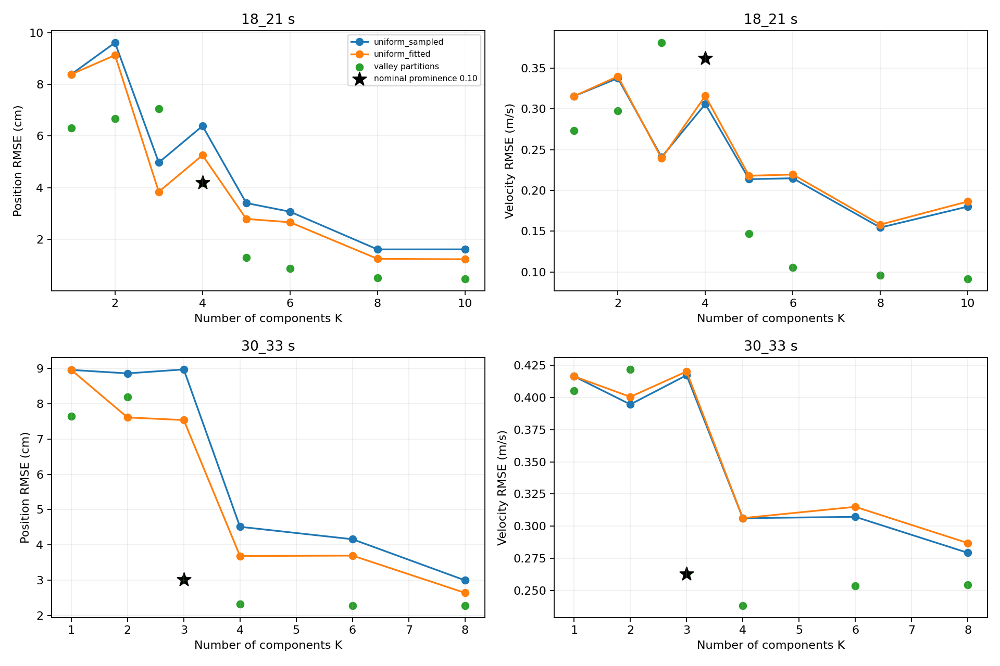

# Minimum Jerk Motion Decomposition

This experiment approximates a recorded right-wrist trajectory with overlapping minimum-jerk displacement components. It asks how motion structure can guide the number and timing of components, while fitting their displacements rather than copying intermediate goals from the recording.

**[Read the report (PDF)](report/final_motion_decomposition_report.pdf)** | [Editable Word](report/final_motion_decomposition_report.docx)

## Method

1. Estimate detection speed from the recorded XYZ trajectory and retain prominent speed peaks.
2. Use the speed minimum between consecutive retained peaks to propose movement intervals and a component count.
3. Optimize each component's onset and completion near its proposed interval, allowing overlap.
4. At every timing trial, fit displacement vectors by linear least squares with fixed initial and final positions.
5. Compare reconstruction errors with uniform baselines at the same component count.

The main objective minimizes position error. A supplementary experiment jointly fits position and velocity. [Method and evaluation details](docs/method.md) describe the equations, parameter settings and comparisons.

## Data and results

The input is the right wrist from the ACCAD **D3 Conversation Gestures** clip in AMASS, extracted using SMPL+H. The analysis uses two separate 3-second windows from the same clip, sampled at 120 Hz. [Data preparation](docs/data_preparation.md) describes the source and coordinates.

| Window | Components | Method | Position RMSE (cm) | Velocity RMSE (m/s) |
|---|---:|---|---:|---:|
| 18-21 s | 4 | Uniform sampled goals | 6.387 | 0.3061 |
| 18-21 s | 4 | Uniform timing, fitted displacements | 5.254 | 0.3160 |
| 18-21 s | 4 | Speed intervals, fitted timing and displacements | 4.194 | 0.3620 |
| 30-33 s | 3 | Uniform sampled goals | 8.969 | 0.4172 |
| 30-33 s | 3 | Uniform timing, fitted displacements | 7.535 | 0.4201 |
| 30-33 s | 3 | Speed intervals, fitted timing and displacements | 3.022 | 0.2631 |

The proposed method lowers position RMSE in both windows. Velocity RMSE worsens in the first window and improves in the second. Adding a velocity objective reduces velocity RMSE in both windows at a cost in position accuracy; no universally preferred weight is established.



Saved evidence:

- [Main comparisons](results/mainline/metrics.csv), [count sensitivity](results/mainline/count_sweep.csv), and [fitted goals and timing](results/mainline/goals.csv).
- [Timing-neighborhood sensitivity](results/timing_bound_sensitivity/metrics.csv).
- [Joint position/velocity comparison](results/velocity_objective/metrics.csv).

## Limitations

Speed-based intervals and counts are heuristic and depend on filtering and peak selection. Changing the count-selection setting also changes the partition, so the count curves do not isolate count alone. Local timing bounds affect the fit. Intermediate cumulative goals need not be visited during overlap, and the model has zero analytical velocity at the crop endpoints even when the recorded wrist is moving. These two windows do not establish physiological movement units, whole-body feasibility or generalization to other clips.

## Reproduce

The tested environment is WSL Ubuntu with Python 3.10.12. The included [processed trajectory](data/wrist_trajectory.npz) is sufficient for fitting; original AMASS and body-model assets are not required unless repeating extraction.

Run from the repository root:

```bash
python3 -m venv .venv
source .venv/bin/activate
python3 -m pip install -r requirements.txt
export OPENBLAS_NUM_THREADS=1
export OMP_NUM_THREADS=1

python3 -m motion_decomposition.final_pipeline
python3 -m motion_decomposition.complete_mainline
python3 -m motion_decomposition.export_mainline_goals
python3 -m motion_decomposition.timing_bound_sensitivity
python3 -m motion_decomposition.velocity_objective
```

`final_pipeline` prepares the uniform baselines and a separate unrestricted-timing control. `complete_mainline` runs the locally constrained speed-interval method and count comparisons. A fresh run without local checkpoints recomputes the control fits and may take longer.

Check the saved results and run tests:

```bash
python3 -m motion_decomposition.audit_report_evidence
python3 scripts/audit_velocity_results.py
python3 -m unittest discover -s tests -q
```

## Repository

| Directory | Contents |
|---|---|
| `motion_decomposition/` | Fitting, count proposals, baselines and evaluation |
| `data/` | Processed wrist trajectory |
| `results/` | Reconstructions, figures, metrics and run records |
| `tests/` | Numerical tests |
| `scripts/` | Optional data extraction and result checks |
| `docs/` | Method, data preparation and references |
| `report/` | Current PDF and editable Word report |

The overlapping representation follows Sato, Mitake and Hasegawa (2025), [Artist-Directable Motion Generation Using Overlapping Minimum Jerk Trajectories](https://doi.org/10.1002/cav.70075). See [references](docs/references.md) for the other sources and implementation attribution.
