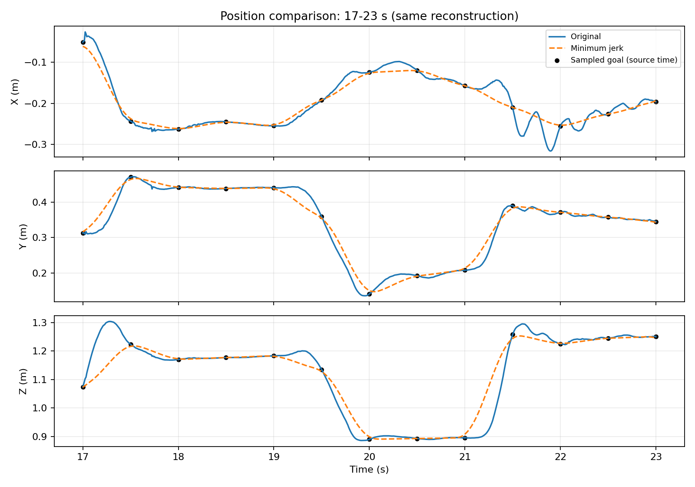

# Minimum-Jerk Motion Approximation

This project approximates the **right-wrist trajectory from one motion capture clip** using a sequence of overlapping minimum jerk trajectories. It includes the extraction and reconstruction code, position and velocity comparison figures, and a report describing goal selection and limitations.

The initial experiment is complete. It is a small-scale study of converting motion data into minimum jerk goals; no learning model or full-body motion generation system is implemented.

## Report and Results

- [Experiment report (PDF)](report/report.pdf)
- [Position comparison](results/figures/position_comparison.png)
- [Position comparison detail, 17-23 seconds](results/figures/position_comparison_detail.png)
- [Velocity comparison](results/figures/velocity_comparison.png)



The reconstruction follows many broad position changes and relatively steady portions of the source trajectory. It misses some brief peaks and rapid changes, including the Z peak near 17.3 seconds and X oscillations around 21.5-22 seconds. Velocity peak amplitudes and timing also differ.

These observations concern one wrist, one clip, and one goal/timing setting. They do not establish a general limit of minimum jerk approximation.

## Motion Data and Extraction

| Item | Value |
| --- | --- |
| Dataset | ACCAD subset of AMASS |
| Clip | `Female1Gestures_c3d/D3 - Conversation Gestures_poses.npz` |
| Frames | 6,086 |
| Frame rate | 120 Hz |
| Duration | Approximately 50.7 seconds |
| Body model | Female SMPL+H, 16 shape coefficients |
| Joint | Right wrist, index 21 (zero-based); parent joint 19 |
| Coordinates | Global XYZ positions in meters, including root orientation and translation |

`src/extract_wrist.py` processes **all frames** in batches of 32 and saves a `(6086, 3)` position array. No temporal cropping, resampling, or smoothing is applied. In this project, the original trajectory means wrist positions computed from the clip's pose, shape, root orientation, and translation parameters using SMPL+H.

Timestamps are `t_k = k / 120`, from 0 to 50.708333 seconds. The frame-count duration, `6086 / 120`, is 50.716667 seconds; the final sample timestamp is one sample interval shorter.

The original data can also be viewed as a [3D path](results/figures/original_trajectory_3d.png) and [XYZ positions over time](results/figures/original_position.png).

## Goal Selection and Reconstruction

Goal positions are sampled every **0.5 seconds** (60 frames). Frame 0 supplies the initial position, and the last frame is always included. This produces **102 goals in addition to the initial position**. The final source sampling interval is shorter than 0.5 seconds.

For consecutive sampled positions `g_(i-1)` and `g_i` with source timestamps `t_(i-1)` and `t_i`, activation and completion times are:

```text
a_i = max(first_timestamp, t_(i-1) - 0.125)
b_i = min(last_timestamp, t_i + 0.125)
```

Neighboring instances overlap by **0.25 seconds**. The sampling interval and overlap are simple initial experimental choices, not optimized parameters or settings prescribed by the reference paper. Source timestamps identify where goal positions were sampled; they are not instance completion times.

Following the position-displacement formulation of Sato et al. (2025), each instance uses normalized time `u = (t - a_i) / (b_i - a_i)`:

```text
s_i(t) = 0                         if t < a_i
         10u^3 - 15u^4 + 6u^5      if a_i <= t <= b_i
         1                         if t > b_i

p_hat(t) = g_0 + sum_i [(g_i - g_(i-1)) * s_i(t)]
```

The reconstruction sums overlapping displacements rather than sequentially concatenating rest-to-rest segments. Although each individual instance starts and ends with zero velocity and acceleration, the combined trajectory need not stop at intermediate goals. It is not constrained to pass exactly through every goal at its source timestamp or completion time.

Both trajectories are evaluated at the original timestamps. Velocity is estimated with `numpy.gradient`, using centered interior differences and second-order one-sided endpoint differences (`edge_order=2`). The same method is applied to both trajectories, without filtering. Differentiation emphasizes small fluctuations, and these comparisons do not determine whether the source fluctuations reflect movement, fitting artifacts, or noise.

## Running the Experiment

The scripts have been run successfully in Ubuntu WSL with Python 3.10.12, `human-body-prior==0.8.5.0`, and `smplx==0.1.28`. They also require NumPy, PyTorch, and Matplotlib. A complete dependency lockfile and a tested fresh-environment installation procedure are not yet provided.

A scoped adapter in `extract_wrist.py` handles the installed packages' `lbs` signature mismatch: the older caller supplies `dtype`, while the installed `smplx` implementation infers it from the input tensor. Installed packages are not modified.

Obtain the motion data and body model separately under their respective licenses and place them at:

```text
ACCAD/Female1Gestures_c3d/D3 - Conversation Gestures_poses.npz
smplh/female/model.npz
```

With the working Python environment active, run from the repository root:

```bash
python3 src/inspect_motion.py
python3 src/extract_wrist.py
python3 src/plot_wrist.py
python3 src/approximate_wrist.py
python3 src/verify_results.py
```

All scripts resolve input and output paths relative to their own file location. Extraction and reconstruction overwrite their corresponding result files, and plotting overwrites the figures. Verification reads the saved trajectory without changing experiment outputs.

| Script | Purpose |
| --- | --- |
| `src/inspect_motion.py` | Print array shapes, frame count, frame rate, and duration |
| `src/extract_wrist.py` | Extract and save the complete right-wrist trajectory |
| `src/plot_wrist.py` | Plot the original 3D path and XYZ positions |
| `src/approximate_wrist.py` | Select goals, reconstruct positions, estimate velocities, and plot comparisons |
| `src/verify_results.py` | Check known formula values, hand-calculated displacement sums, and extraction consistency |

## Verification

The following checks passed in the working WSL environment:

- Progress values before/start/midpoint/end/after a 2-4 second instance match `[0, 0, 0.5, 1, 1]` within absolute tolerance `1e-12`.
- For a unit-duration instance, one-sided finite differences with `h=0.001` give endpoint velocities about `-1.99e-5` and accelerations about `+/-3.29e-4`, within tolerances `3e-5` and `1e-3`. These are numerical estimates of zero endpoint derivatives, not measured wrist velocities or accelerations.
- Five positions in a two-instance overlapping example match hand-calculated XYZ values within `1e-12`.
- Frames 0, 31, 32, 3000, and 6085 were computed individually and in a batch and compared with the saved trajectory. The maximum absolute coordinate discrepancy was approximately `5.96e-8 m`, below the `1e-6 m` tolerance for float32 model arithmetic.
- The saved trajectory has the expected shape, finite positions, and timestamps equal to frame indices divided by frame rate.

These checks support the tested calculations and extraction consistency. They do not independently establish anatomical ground truth or prove that the selected goals give an accurate approximation.

## Repository Contents

```text
report/report.pdf             Experiment report
src/                          Extraction, approximation, plotting, and verification code
results/
|-- wrist_trajectory.npz       Original positions, timestamps, and extraction metadata
|-- goals.npz                  Goal positions, source indices, and activation/completion times
|-- approximation.npz          Reconstructed positions and both velocity estimates
`-- figures/                  Original and comparison figures
```

The data and models are local assets. `.gitignore` excludes `ACCAD/`, `models/`, `smplh/`, and the temporary build directory `tmp/`. The scripts use `smplh/female/model.npz`, not the additional local model copies under `models/`.

## Reference

H. Sato, H. Mitake, and S. Hasegawa. "Artist-Directable Motion Generation Using Overlapping Minimum Jerk Trajectories for Interactive Embodied Social Agent Adapting to Dynamic Environments." *Computer Animation and Virtual Worlds*, 36, e70075, 2025. [DOI: 10.1002/cav.70075](https://doi.org/10.1002/cav.70075).

Relevant sections: 3.3-3.6 (representation and trajectory generation), 6.2 (switchability and failures), and 7 (limitations).
