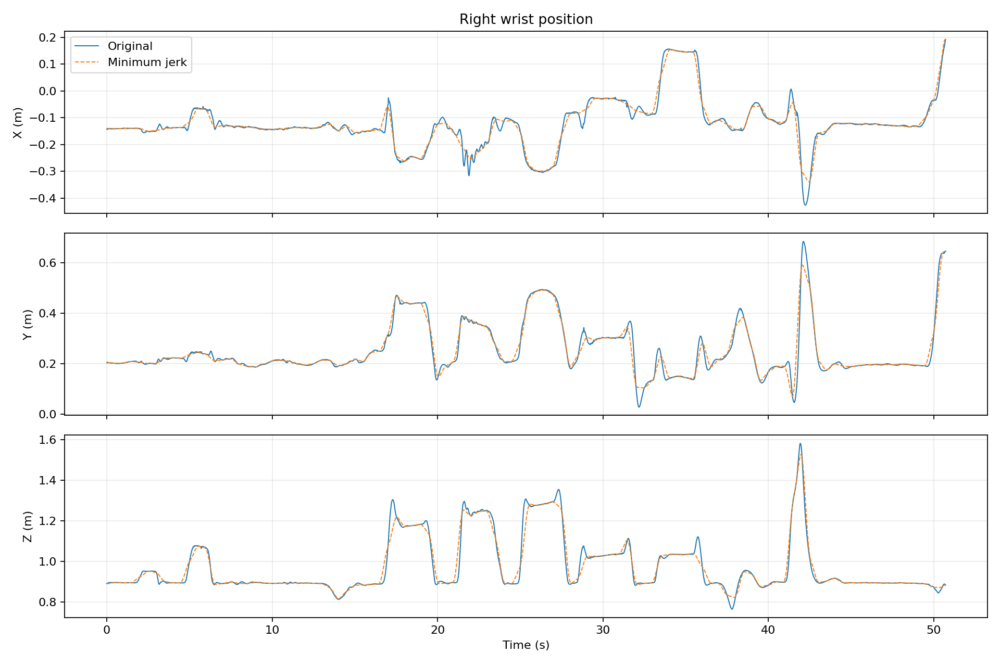
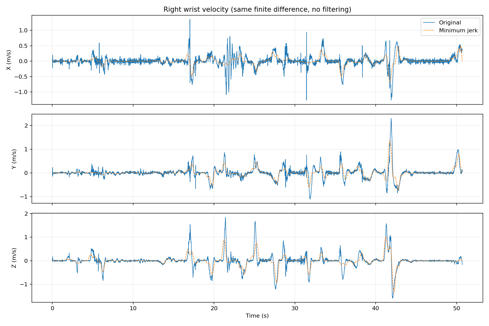

# Minimum-Jerk Approximation of a Motion Capture Wrist Trajectory

## 1. Objective and Motion Data

This preliminary experiment examines how the trajectory of one wrist from a motion capture clip can be approximated by a sequence of minimum jerk trajectories. The original and approximated trajectories are compared in terms of position and velocity, with attention to how the goals are selected and which motion features are not reproduced well.

The experiment uses the clip `Female1Gestures_c3d/D3 - Conversation Gestures_poses.npz` from the ACCAD subset of AMASS. The clip contains 6,086 frames at 120 Hz, corresponding to approximately 50.7 seconds of motion. The full clip is used without temporal cropping or resampling.

The right wrist position is computed at every frame using the female SMPL+H body model with the clip's pose, shape, root orientation, and translation parameters. The resulting trajectory contains 6,086 three-dimensional positions in global coordinates, expressed in meters. The frame timestamps are defined as `t_k = k / 120`, for `k = 0, ..., 6085`. No smoothing is applied to the extracted trajectory.

In this report, the "original trajectory" refers to these wrist positions computed from the motion capture parameters using SMPL+H.

## 2. Goal Selection and Reconstruction

### 2.1. Goal selection

As a simple initial rule, goal positions are sampled from the original wrist trajectory every 0.5 seconds, equivalent to 60 frames at 120 Hz. The first frame supplies the initial position, and the last frame is always included. This gives 102 goal positions in addition to the initial position. The final sampling interval is shorter than 0.5 seconds because the clip does not end on a regular sampling boundary.

Let `g_0` be the initial wrist position and `g_i` the subsequent sampled goal positions, with source timestamps `t_i`. These positions are taken directly from the original trajectory; no optimization or learning is used to select them. The 0.5-second interval is an initial experimental choice, rather than an optimized value.

### 2.2. Activation and completion times

Each minimum jerk instance has an activation time `a_i` and a completion time `b_i`. For the displacement from `g_(i-1)` to `g_i`, the times are set as:

```text
a_i = max(t_0, t_(i-1) - 0.125)
b_i = min(t_end, t_i + 0.125)
```

Thus, each source sampling interval is extended by 0.125 seconds on either side, except where it meets the clip boundaries. Neighboring instances overlap by 0.25 seconds. For example, the source intervals 1.0-1.5 seconds and 1.5-2.0 seconds become active intervals 0.875-1.625 seconds and 1.375-2.125 seconds, respectively.

The overlap duration is also an initial experimental choice. A goal's source timestamp identifies where its position was sampled; it is not the instance's completion time. Because instances overlap, the reconstructed trajectory is not constrained to pass exactly through every sampled goal at its source timestamp or completion time.

### 2.3. Overlapping minimum jerk reconstruction

Following the position-displacement formulation in Sato et al. (2025), Section 3.4.1, the reconstruction sums minimum jerk displacements. For each instance, define normalized time `u_i = (t - a_i) / (b_i - a_i)` and the progress function:

```text
s_i(t) = 0                              for t < a_i
         10u_i^3 - 15u_i^4 + 6u_i^5     for a_i <= t <= b_i
         1                              for t > b_i
```

The reconstructed wrist position is:

```text
p_hat(t) = g_0 + sum_(i=1)^102 [(g_i - g_(i-1)) * s_i(t)]
```

Each instance contributes a displacement from the preceding goal to its own goal. A new instance can start while earlier instances are still active, so their displacement contributions are added at the same time. Although each individual progress function has zero velocity and acceleration at its endpoints, the combined trajectory need not stop at each intermediate goal.

The reconstruction is evaluated at the original 120 Hz timestamps. For velocity comparisons, both the original and reconstructed positions are differentiated using the same numerical method: NumPy's `gradient` with the timestamps, centered differences at interior samples, and second-order one-sided differences at the endpoints (`edge_order=2`). No filtering is applied.

## 3. Results and Limitations

### 3.1. Position comparison



*Figure 1. Original (blue solid line) and reconstructed (orange dashed line) right-wrist positions over the full clip. Each panel shows one global coordinate in meters.*

The reconstruction follows many of the broad position changes and relatively steady portions of the original trajectory. However, some short peaks and rapid changes are reduced or missed. Thus, agreement in the overall position pattern does not imply that the original motion is reproduced in detail.


*Figure 2. A closer view of the same reconstruction from 17 to 23 seconds. Black dots indicate sampled goal positions at their source timestamps, not their completion times. This interval is shown to make missed peaks and timing differences visible.*

In Figure 2, the relatively steady Z position around 18-19 seconds is reproduced more closely than the brief Z peak near 17.3 seconds. That peak occurs between the source samples at 17.0 and 17.5 seconds, and neither selected goal captures its maximum. The X oscillations around 21.5-22 seconds are also not reproduced. These examples show that uniform sampling can omit motion features between goals.

Timing differences are also visible. For example, the reconstructed rise in Z toward 21.5 seconds begins earlier than the corresponding sharp rise in the original trajectory. The activation and completion times are assigned by a fixed rule rather than fitted to the observed movement; this is a plausible contributor to the timing differences. This run does not separately measure the effects of goal sampling and overlap timing.

### 3.2. Velocity comparison



*Figure 3. Numerically estimated XYZ velocity components of the original and reconstructed trajectories, in meters per second. Both use the same differentiation method and timestamps, without filtering.*

The reconstructed velocity captures some broad movement trends but does not reproduce many sharp velocity peaks or their amplitudes. For example, the positive Y velocity peak near 42 seconds is substantially lower in the reconstruction. Position curves that appear close at the full-clip scale can therefore still differ in velocity.

The original velocity also contains small rapid fluctuations. Numerical differentiation emphasizes such fluctuations, and this comparison does not determine whether they arise from motion, motion-capture fitting, or noise. They should not automatically be interpreted as meaningful movement that the approximation must reproduce.

### 3.3. Scope of the findings

With the current fixed goal and timing rule, overlapping minimum jerk trajectories reproduce some broad features of this wrist motion, while missing brief extrema, rapid oscillations, and parts of the velocity profile. These observations apply to one clip, one wrist, and one parameter setting. They do not establish that other goal choices would have the same limitations, or that minimum jerk trajectories cannot approximate those features.

## 4. Implementation Checks and Reproduction

The implementation was checked using known minimum jerk progress values, numerical estimates of endpoint velocity and acceleration, and hand-calculated positions for two overlapping instances. All checks passed within the specified numerical tolerances. In addition, five frames (0, 31, 32, 3000, and 6085) were computed individually and in a batch and compared with the saved wrist trajectory. The maximum absolute coordinate difference was approximately `5.96e-8 m`, below the `1e-6 m` tolerance used for these float32 calculations. These checks support calculation consistency; they do not independently validate anatomical ground truth or establish approximation accuracy.

The experiment was run in Ubuntu WSL with Python 3.10.12, `human-body-prior` 0.8.5.0, and `smplx` 0.1.28. It also uses NumPy, PyTorch, and Matplotlib. The complete dependency versions have not yet been recorded, so a fresh-environment installation is not yet documented. A local adapter in `extract_wrist.py` handles the incompatible `dtype` argument between the installed body-model packages without modifying them.

With the working Python environment active, place the selected motion file at `ACCAD/Female1Gestures_c3d/D3 - Conversation Gestures_poses.npz` and the female body model at `smplh/female/model.npz`. From the repository root, run:

```bash
python3 src/inspect_motion.py
python3 src/extract_wrist.py
python3 src/plot_wrist.py
python3 src/approximate_wrist.py
python3 src/verify_results.py
```

The extracted trajectory is saved in `results/wrist_trajectory.npz`; goal positions and timing are saved in `results/goals.npz`; reconstructed positions and both velocity estimates are saved in `results/approximation.npz`. Figures are written to `results/figures/`. The verification script reads the saved trajectory without changing the experiment outputs. The motion data and body model must be obtained separately under their respective access and license conditions.

## Reference

H. Sato, H. Mitake, and S. Hasegawa. "Artist-Directable Motion Generation Using Overlapping Minimum Jerk Trajectories for Interactive Embodied Social Agent Adapting to Dynamic Environments." *Computer Animation and Virtual Worlds*, 36, e70075, 2025. [https://doi.org/10.1002/cav.70075](https://doi.org/10.1002/cav.70075).
