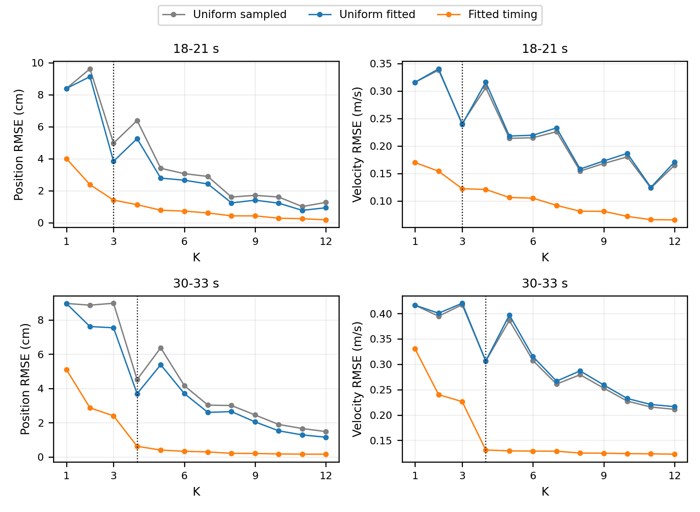
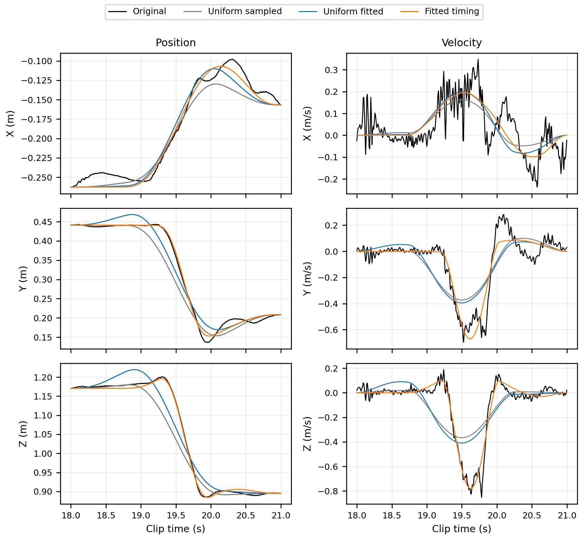
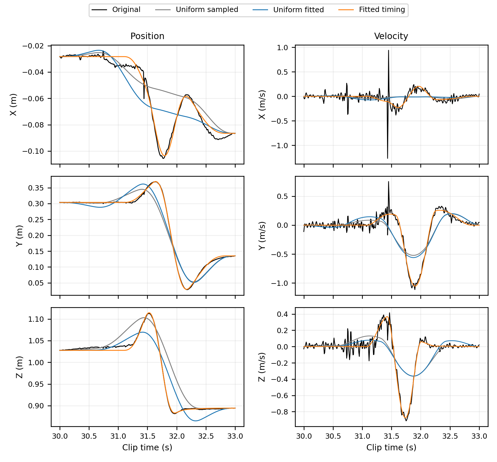

# 固定間隔基準比較

這是原研究的交付收尾，不是新增選數方法。沿用兩段資料、K=1–12 與已保存的新方法結果，補上明確的均勻時間對照。完整英文報告：[Word](../report/fitting_and_goal_selection_report.docx)、[PDF](../report/fitting_and_goal_selection_report.pdf)。

## 三種方法

| 方法 | 時間安排 | 位移／位置 |
|---|---|---|
| 均勻時間、取樣 goals | K 個等長時間區間，內部兩側各延伸區間長度的 25% | 取等間隔結束時間的原始位置，非整數幀用線性內插 |
| 均勻時間、擬合位移 | 與上列完全相同 | 固定端點下擬合位移，使用與新方法相同的反向貢獻懲罰 |
| 擬合時間與位移 | 既有十組時間初猜中的最佳有效解，時間可自由改變 | 與時間共同擬合位移 |

三者使用相同原始位置目標、觀測起終點、K、重疊 minimum-jerk 表示與有限差分評估。後兩者的代價均為位置 MSE 加相同尺度／權重的懲罰，lambda=1e-6、L=0.3 m。K=6 對應三秒內每 0.5 秒一個 goal、相鄰重疊 0.25 秒，與第一版配方對應；其餘 K 的重疊按區間長度縮放，並非一律固定 0.25 秒。

各法獨立重建每個片段，邊界皆以該段觀測位置為準，所以這不是把舊版完整 clip 重建直接裁切；舊結果與本表不能不加說明地混用。

## 相同 K 的主要結果

| 片段／K | 方法 | 位置 RMSE cm | 速度 RMSE m/s | 最大位置誤差 cm |
|---|---|---:|---:|---:|
| 18–21 秒／3 | 均勻時間、取樣 goals | 4.970 | 0.2410 | 13.677 |
| 18–21 秒／3 | 均勻時間、擬合位移 | 3.837 | 0.2393 | 9.205 |
| 18–21 秒／3 | 擬合時間與位移 | 1.414 | 0.1223 | 2.467 |
| 30–33 秒／4 | 均勻時間、取樣 goals | 4.513 | 0.3062 | 11.946 |
| 30–33 秒／4 | 均勻時間、擬合位移 | 3.686 | 0.3063 | 8.287 |
| 30–33 秒／4 | 擬合時間與位移 | 0.618 | 0.1310 | 1.570 |

在這兩段的全部 K=1–12，新方法的位置與速度 RMSE 都低於兩個均勻基準。但固定時間控制只有一個線性最小平方法位移初猜，新方法有十組時間初猜，而且自由度與實際計算成本不同；不能將改善全部歸因於時間這個單一因素，或宣稱已知全域最佳。擬合位置也不保證速度一定改善，例如第二段 K=4 的兩種均勻基準速度誤差幾乎相同。

## 重現與驗證

在研究目錄執行 `OPENBLAS_NUM_THREADS=1 python3 -m motion_decomposition.compare_uniform_baseline`；報告尺寸的圖由 `python3 -m motion_decomposition.report_figures` 重畫。新增的 24 組固定時間擬合全部成功，連同取樣基準與沿用新方法共 72 筆方法／片段／K 比較。

獨立核算重建、端點、取樣 goals、位置／速度誤差與目標函數，既有新方法來源雜湊未變；49 項測試通過，三張比較圖與報告七頁均已檢查。這是兩段短資料的同條件比較，不是完整 clip 或跨動作驗證。

原始輸出：[summary.json](../results/uniform_baseline_comparison/summary.json)、[metrics.csv](../results/uniform_baseline_comparison/metrics.csv)、[fits.npz](../results/uniform_baseline_comparison/fits.npz)。所有程式與資料仍在研究目錄，舊兩份 PDF 保留原樣。
