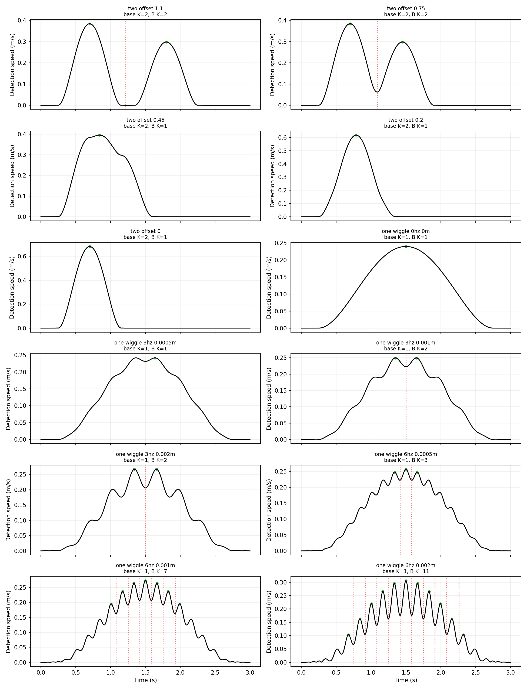
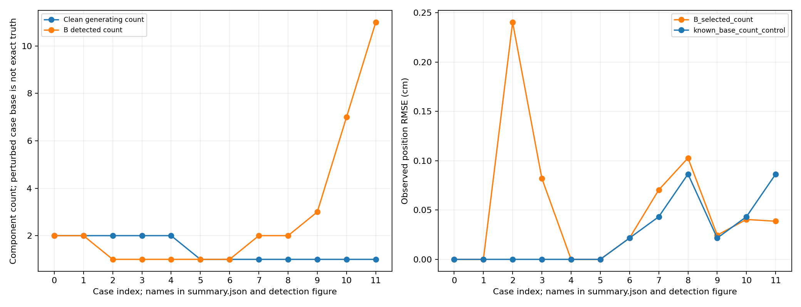
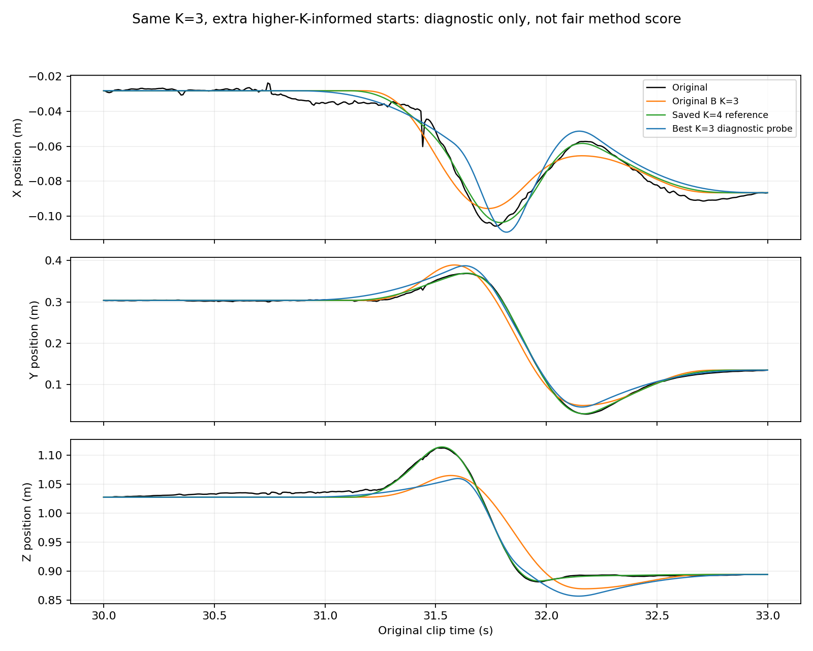

# 第 11 步：速度谷底計數的有限診斷

本步不新增選數方法，也不調整 B 的設定。目的只有兩個：檢查速度谷底是否能辨認已知生成分量，以及區分真實資料中的計數問題與數值搜尋問題。K 表示位移分量／累積 goals 的數量，初始位置另計。

## 怎麼做、為什麼

1. 用 minimum-jerk 公式產生可控軌跡，先知道生成過程，避免直接把真實手腕曲線的峰數當答案。
2. 固定原 B：17 samples、三階 Savitzky–Golay 一階微分；速度峰 prominence 為最大速度的 10%，峰間至少 0.15 秒。相鄰保留峰之間最低速度樣本提供分界，區間數作為 K。只平滑偵測訊號，擬合目標仍是觀測位置。
3. 比較 B 選出的 K 和已知乾淨基底 K 各自的擬合。控制組只知道 K，沒有使用生成時的正確時間或位移作為初猜。
4. 對真實第二段保持 K=3，額外測試六組時間初猜，檢查原搜尋是否漏掉較好的解。

所有擬合沿用固定起終點、時間及位移聯合最佳化、lambda=1e-6、L=0.3 m、最短持續時間 2/120 秒和 max_nfev=1000。每個人造案例每組記錄 10 個初猜，完全相同的初猜只算一次、重用結果，不能視為十次獨立成功。選擇成功且有效結果中總目標函數最低者，不是只挑位置 RMSE。

設定及案例在擬合前寫入 [protocol.json](../results/step11_valley_diagnostic/protocol.json)。人造資料以 120 Hz 生成，含區間外資料供濾波，分析 0–3 秒共 361 點。

## 人造資料結果

兩個分量各持續 0.9 秒；起始時間差依次縮小，位移為 (0.18, 0.04, 0) 與 (0.14, 0.03, 0) m。

| 起始時間差 | 生成 K | B 選 K | B 位置 RMSE | 已知 K 控制組 RMSE |
|---|---:|---:|---:|---:|
| 1.10 秒 | 2 | 2 | 近數值零 | 近數值零 |
| 0.75 秒 | 2 | 2 | 近數值零 | 近數值零 |
| 0.45 秒 | 2 | 1 | 2.404 mm | 近數值零 |
| 0.20 秒 | 2 | 1 | 0.822 mm | 近數值零 |
| 0 秒 | 2 | 1 | 近數值零 | 近數值零 |

重疊會合併速度峰，因此速度谷底不是完整的分量計數依據。最後一列的兩個時間基底完全相同，位移可以相加成一個分量，單憑軌跡無法區分 K=1 或生成時的 K=2；這不是證明 B 判錯。

另一組乾淨基底只有一個分量，持續 0.25–2.75 秒，位移 (0.3, 0.1, 0.05) m。在 X 軸加入振幅 A、頻率 f 的波動：A sin(2 pi f t) sin(pi t/3)^2，區間外為零。

| 波動頻率 | 振幅上限 | B 選 K |
|---|---:|---:|
| 無波動 | 0 | 1 |
| 3 Hz | 0.5 / 1 / 2 mm | 1 / 2 / 2 |
| 6 Hz | 0.5 / 1 / 2 mm | 3 / 7 / 11 |

小幅位置波動可產生明顯速度起伏，增加被辨認的峰數。但波動後的觀測訊號已不是精確的一個 minimum-jerk 分量，因此不能把所有 K>1 都稱為真值錯誤。這是對訊號細節敏感的診斷，不是經過驗證的人體或量測雜訊模型，也不能由這 12 個案例估計一般成功率。

部分案例 B 雖選更多 K，擬合誤差仍高於 K=1 控制組。例如 3 Hz、1 mm：B 的 K=2 為 0.704 mm，控制組 K=1 為 0.432 mm。有限初猜、非線性搜尋及帶懲罰目標不保證位置 RMSE 隨 K 單調改善；這些結果保留，沒有重跑到好看為止。

圖中綠點是保留速度峰，紅虛線是內部分界；面板依序對應下圖的案例 0–11。

## 真實第二段：計數不足，還是搜尋限制？

使用先前保存的 K=4 解，將四個時間區間任取兩個合併為涵蓋兩者的區間，其餘兩個保留，得到六組 K=3 時間初猜。位移重新用固定端點最小平方法初始化，沒有直接合併位移。之後仍自由擬合三組時間及位移。

| 結果 | 位置 RMSE | 速度 RMSE |
|---|---:|---:|
| 原 B，K=3 | 2.3945 cm | 0.2263 m/s |
| 六組額外初猜中的最佳 K=3 | 2.1601 cm | 0.1917 m/s |
| 已保存 K=4 參考 | 0.6181 cm | 0.1310 m/s |

六組皆符合成功與有效性條件，其中 merge_intervals_1_4 找到較好的 K=3 解，其餘五組接近原結果。這證明原搜尋會受初猜影響；仍不能證明三分量的全域最佳誤差是多少，也不能證明四分量就是人體真實動作單元數。

這六組初猜使用較大 K 的資訊、也增加計算量，**只作診斷，不取代原 B 成績或當作公平方法比較**。

## 本步結論及驗證

速度谷底符合教授提出的運動線索，適合作為候選分界；目前證據不支持將谷底數直接宣稱為可靠的最終 goals 數。重疊、波動和擬合搜尋各自影響結果，必須分開說明。這一步完成限制檢查，沒有建立新的自動選數規則，也沒有證明人體動作單元已被辨認。

輸出包含 240 筆人造擬合紀錄與 6 筆真實資料診斷；部分紀錄重用相同初猜結果。獨立核算全部 246 筆重建、固定端點、位置／速度誤差、懲罰及總目標、最佳結果選擇與前步輸入雜湊；49 項既有測試通過。三張圖已視覺檢查。

程式：[step11_diagnose_valleys.py](../motion_decomposition/step11_diagnose_valleys.py)。完整數據：[summary.json](../results/step11_valley_diagnostic/summary.json)、[人造紀錄](../results/step11_valley_diagnostic/synthetic_runs.csv)、[真實初猜紀錄](../results/step11_valley_diagnostic/real_probes.csv)。

重現：在 research/motion_decomposition 執行 `OPENBLAS_NUM_THREADS=1 python3 -m motion_decomposition.step11_diagnose_valleys`。本步未變更 B 參數、舊 A/B 成績或原報告 PDF。
