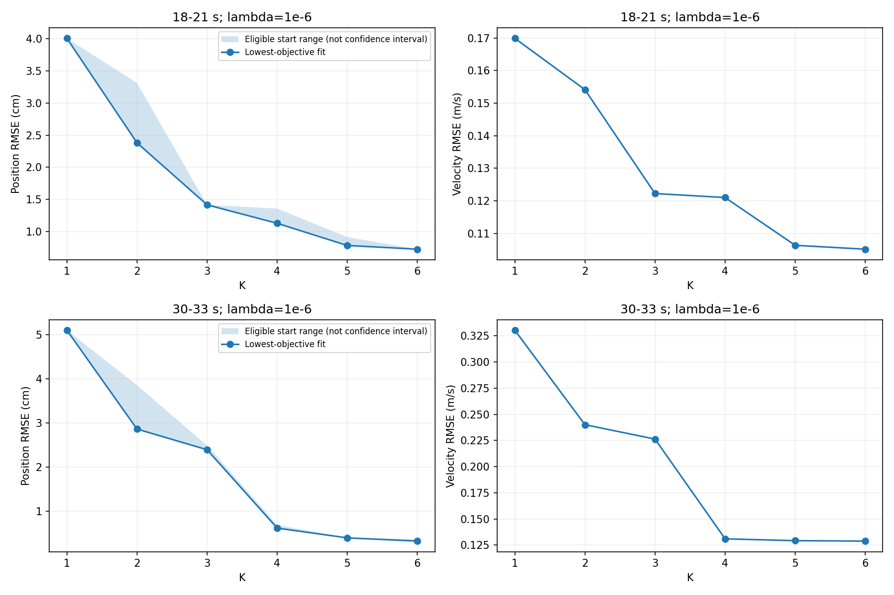
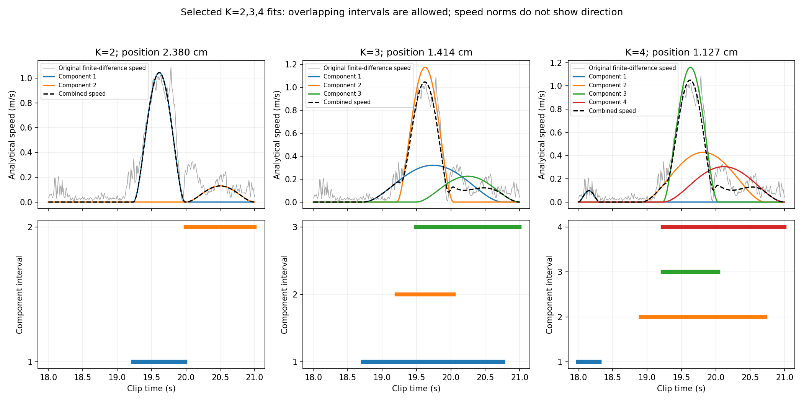
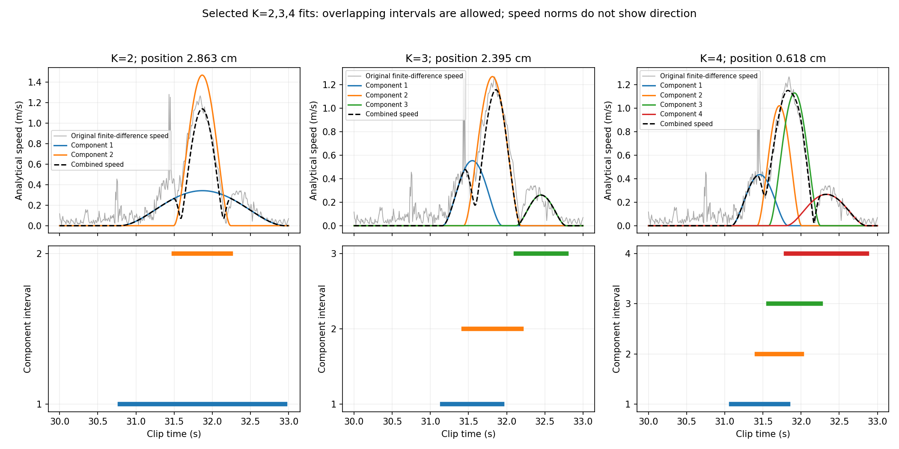

# 第 12 步：既有資料是否支持轉折點選數？

本步只讀取第 9 步保存的兩段 K=1–6、lambda=1e-6 結果，沒有新增擬合、沒有把較晚的額外搜尋結果混入比較，也沒有實作新的 A+B 選數方法。目的是先檢查提出方案的依據是否成立。

## 做了什麼

1. 同時看位置及速度 RMSE，位置圖加上有效初猜結果的最小到最大範圍。陰影是搜尋結果的分散，不是信賴區間；K=1 的十筆初猜完全相同。
2. 用現有 A 的正規化弦線距離規則，分別測試最大 K=3、4、5、6。指標分別為位置 MSE 與原本的帶懲罰總目標。兩者不可與位置 RMSE 混稱為同一條曲線。
3. 分別只保留均勻初猜族、速度初猜族，以及每次移除一筆初猜，重新從已保存結果中選解。這是對現有搜尋池的敏感度檢查，不是新隨機種子實驗或獨立重複驗證。
4. 畫出 K=2、3、4 的已選分量速率及時間區間。灰線為原始位置有限差分所得速率；彩線為各分量解析速率；黑虛線為速度向量相加後的速率。彩線的高度不能直接相加，也不能只靠速率判定方向抵銷或人體動作意義。

## 曲線與初猜結果

使用全部初猜、依總目標選解時：

| 片段 | 測試上限 K=3 | K=4 | K=5 | K=6 |
|---|---:|---:|---:|---:|
| 18–21 秒的轉折點 | 2 | 2 | 2 | 3 |
| 30–33 秒的轉折點 | 2 | 2 | 2 | 2 |

本資料中，改用位置 MSE 得到相同表格。第一段只保留均勻初猜時，上限 K=3 的曲線非單調，規則回報無法選擇；上限 4–6 則選 K=3。速度初猜族與完整池的上表一致。固定上限為 6 時，兩初猜族與十種逐筆移除結果皆分別選出第一段 K=3、第二段 K=2；這種有限穩定性不代表全域最佳或普遍可靠。

**第一段有範圍依賴；第二段則顯示穩定不等於足夠。** 第二段位置 RMSE 隨 K 為 5.102、2.863、2.395、0.618、0.397、0.324 cm。雖然規則一直選 K=2，K=3 到 K=4 仍有 1.776 cm 的改善，速度 RMSE 也由 0.2263 降至 0.1310 m/s。不能把 K=2 稱為已經捕捉所有重要結構，或宣稱之後改善都很小。

原因之一是現有規則比較的是每個點與整條端點連線的距離，並不保證找出「最後一次重要改善」。正規化、MSE 的尺度變化與有限比較範圍都會影響判斷。本步沒有為了讓第二段選四而修改規則。

## 候選分量長什麼樣？

第一段 K=2 的兩個分量幾乎前後接續；K=3 的三個分量則明顯重疊，並重新安排整組區間。K=4 並不是保持原三個分量後單純補上一個：它包含開頭短小分量及重新擬合的其他分量。不能把不同 K 圖中的相同編號當作相同動作。

第二段 K=2 使用一個寬分量與一個較短、重疊的分量。K=4 則用四個重疊分量表示轉換，位置與速度誤差明顯下降。但這些區間是模型擬合出的描述，單靠這張圖不足以判定四個就是人體真實動作單元。

第 11 步另外找到較好的 K=3 解（2.1601 cm），已證明初猜限制仍存在。本步保留原比較數據，不把額外六次搜尋的成果不對稱地替換進原曲線；因此這裡也不能聲稱所有 K 已充分搜尋。

## 結論與下一步邊界

現有證據不支持直接把「速度谷底初猜 + 現有單一轉折點」宣布為完成的自動選數方案。速度谷底可以提供初猜；現有 A 可以產生候選 K，但尚不足以決定最終 K。這是對先前方案的限制檢查，不是已解決教授要求。

下一個方法討論應集中處理：如何避免停在較早轉折而漏掉後續重要改善，並區分搜尋不足與數量不足。尚未選定新的準則，不應自行套入新的誤差門檻、把 K=4 當答案，或另開大量方法分支。

## 重現與驗證

在 research/motion_decomposition 執行 `OPENBLAS_NUM_THREADS=1 python3 -m motion_decomposition.step12_inspect_count_evidence`。

程式：[step12_inspect_count_evidence.py](../motion_decomposition/step12_inspect_count_evidence.py)。輸出：[完整結果](../results/step12_count_evidence/summary.json)、[12 個曲線點](../results/step12_count_evidence/metrics.csv)、[208 組敏感度檢查](../results/step12_count_evidence/knee_sensitivity.csv)、[18 個分量參數](../results/step12_count_evidence/components.csv)。

獨立核算 208 個轉折判斷及其來源、12 個曲線點的位置與速度 RMSE；來源雜湊未改變。49 項既有測試通過，三張圖已檢查。舊報告 PDF 與方法成績不變。
