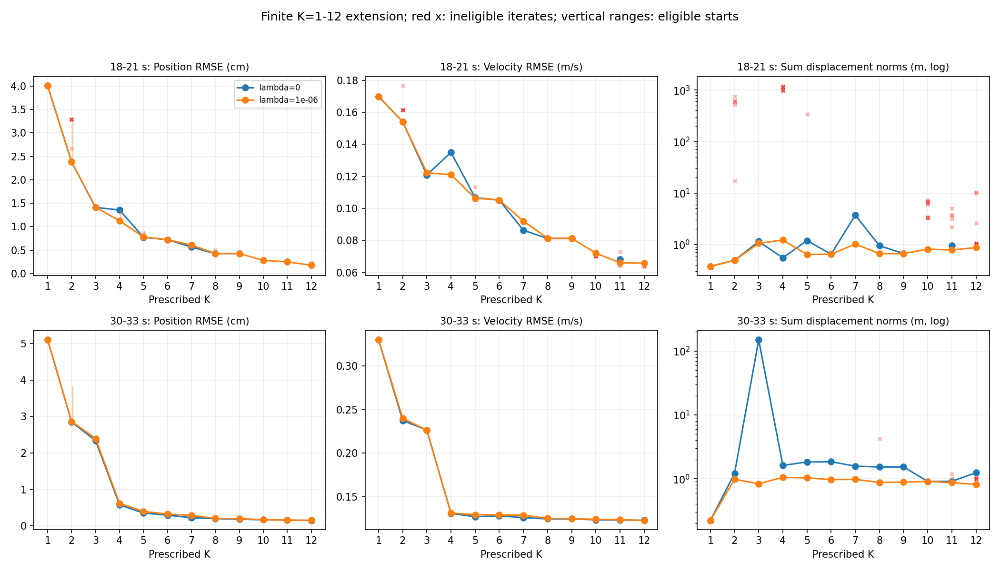
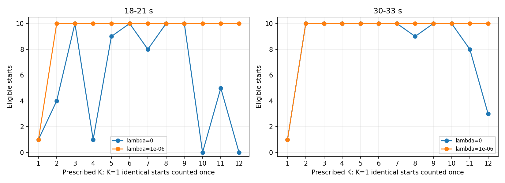
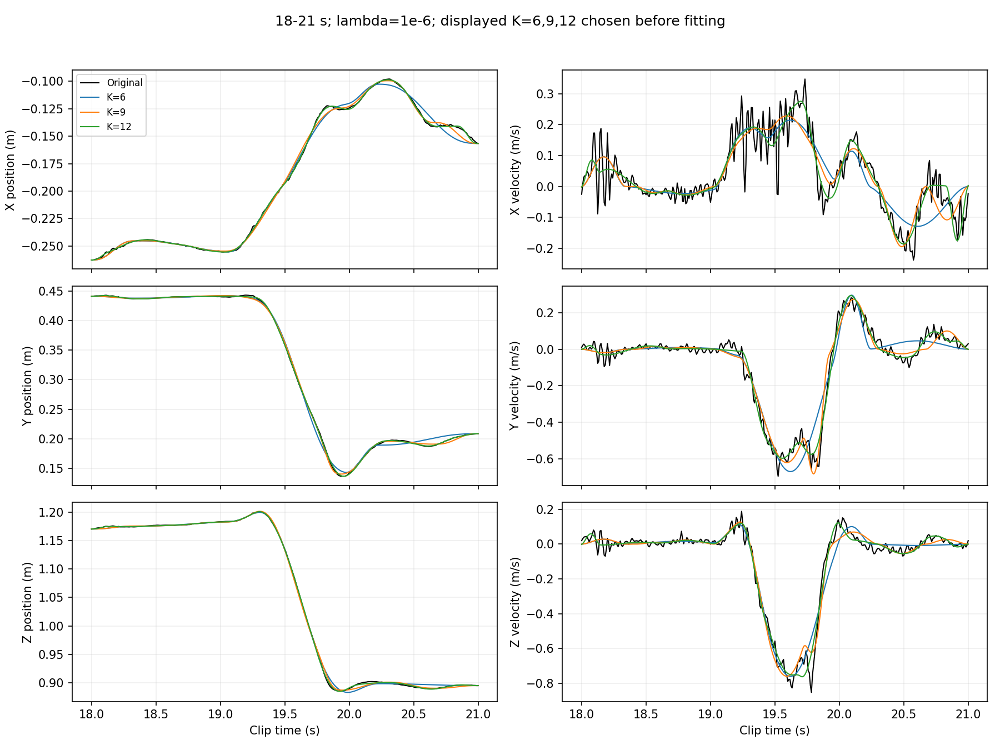
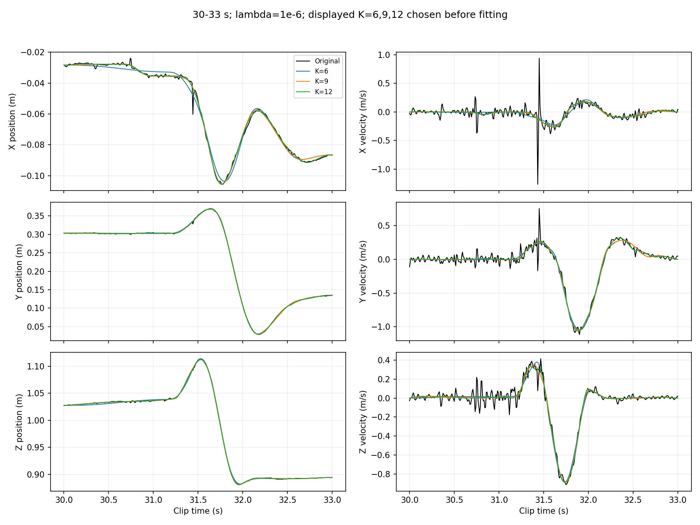

# 第 14 步：把有限比較延伸到 K=12

本步已完成。目的為檢查 K=6 邊界是否限制先前觀察，不是新自動選數方法，也不是宣稱十二具有生理意義。新增 240 次擬合，加上原有紀錄共 480 筆；有懲罰條件下兩段 K=1–12 均有有效解，但部分無懲罰條件未收斂。

## 預先固定的實驗

- 相同 AMASS 動作、右手腕、18–21 與 30–33 秒兩個片段，每段 361 點。
- K=1–6 直接沿用第 9 步保存的 240 筆紀錄，不替換第 10、11 步額外搜尋得到的解。
- 新增 K=7–12；兩個片段、兩個權重（0 與 1e-6）、各十組初猜，共 240 次新擬合。每個 K 仍以五組均勻及五組速度最低點初猜產生，seed=23、擾動比例 0.2、初始重疊比例 0.25。
- 端點固定，時間和位移聯合最佳化；L=0.3 m、最短持續時間 2/120 秒、每次 max_nfev=1000。無論成功與否都保存最後迭代，不用失敗結果取代正式選解。
- 每個片段、K、權重，選有效結果中總目標函數最低者；如果沒有有效結果就留空。
- 同樣的每次擬合預算不代表總計算成本相同。K 增加會增加參數、成對懲罰項與數值導數成本；本次由兩個工作程序開始，完成 66 筆後改用四個程序接續，底層數值執行緒各為一。未完成的初猜從原始初始化重跑；不同並行條件與被中斷的部分計算，不作公平執行時間比較。見 [執行紀錄](../results/step14_extended_counts/execution_notes.json)。
- 事先指定展示 K=6、9、12 的位置／速度圖；全部 K 的數據都保存。
- 另試算上限 6、8、10、12 的原轉折規則與 BIC 形式分數，只觀察範圍依賴。第 13 步指出的時間相關、非全域估計與奇異模型限制仍存在。

## 要觀察什麼

1. K>6 後，位置及速度誤差是否仍明顯下降。
2. 不同初猜的結果分散及有效擬合數，避免把搜尋不足當作數量不足。
3. 位移模長總和、反向貢獻懲罰及分量路徑長度超額，檢查增加分量的代價。路徑長度超額也受方向差異影響，不能直接當作不必要抵銷比例。
4. 原選數規則是否仍選到邊界。本步結束後不自動繼續提高上限追答案。

## 為何提高 K 後較慢？

固定起終點時，自由參數為 5K-3：K=6 有 27 個，K=12 有 57 個。分量配對數也由 15 增至 66。現在的數值微分求解器每次還要擾動各參數計算導數，因此 max_nfev=1000 不等於只呼叫殘差函式一千次；紀錄中的 residual_evaluations 才包含這些實際呼叫。多分量除了可能改善誤差，也增加搜尋困難。本次不因為較慢就降低某些 K 的預算，也不因為未收斂就無限延長。

## 結果一：K>6 確實仍能改善

以下為 lambda=1e-6、依各組總目標選出的有效解，位置單位為 cm，速度單位為 m/s：

| K | 第一段位置 RMSE | 第一段速度 RMSE | 第二段位置 RMSE | 第二段速度 RMSE |
|---:|---:|---:|---:|---:|
| 6 | 0.7237 | 0.10517 | 0.3237 | 0.12885 |
| 7 | 0.6094 | 0.09207 | 0.2891 | 0.12867 |
| 8 | 0.4281 | 0.08139 | 0.2056 | 0.12497 |
| 9 | 0.4275 | 0.08130 | 0.1978 | 0.12473 |
| 10 | 0.2813 | 0.07202 | 0.1694 | 0.12389 |
| 11 | 0.2491 | 0.06607 | 0.1579 | 0.12350 |
| 12 | 0.1785 | 0.06576 | 0.1545 | 0.12271 |

第一段 K=8 到 9 幾乎沒有改善，之後 K=10 卻再次改善；這不支持「一輪改善很小就停止」。另一方面，K=11 到 12 的位置仍改善約 0.705 mm，速度改善只有約 0.00031 m/s。第二段 K=11 到 12 的位置改善約 0.034 mm，速度改善約 0.00079 m/s。位置和速度不能只用單一改善幅度概括，也不能把較小位置誤差自動解讀為更真實的人體分解。



橘線為有懲罰條件；藍線為無懲罰條件。紅叉是未符合有效條件的最後迭代值，不是正式選解。垂直線是有效初猜結果範圍，不是信賴區間。無有效解的 K 留空；不能跨空白把兩點解讀成連續趨勢。

K=12 的有懲罰選解，其位移模長總和分別約 0.870 m、0.818 m，沒有出現先前數百到數千公尺的巨大位移。但較小模長總和不是動作單元真實性的證明，也不能保證所有抵銷皆不必要或已消除。lambda 跨 K 相同，仍不等於每個配對的懲罰負擔相同。

## 結果二：較大 K 的搜尋可靠性仍有限

新增的有懲罰擬合全部 120 次符合有效條件；新增的無懲罰擬合有 37/120 次用完 max_nfev 預算，未視為有效解。各組有缺失的有效解數量如下，其餘新增組都是 10/10：

| 無懲罰條件 | K | 有效解數 / 10 |
|---|---:|---:|
| 第一段 | 7 | 8 |
| 第一段 | 10 | 0 |
| 第一段 | 11 | 5 |
| 第一段 | 12 | 0 |
| 第二段 | 8 | 9 |
| 第二段 | 11 | 8 |
| 第二段 | 12 | 3 |



K=1 的十筆紀錄來自同一初猜，圖中只計為一個。成功回報不代表全域最優；未成功也不代表該 K 無法達到好的誤差。第一段 K=10、12 的無懲罰條件完全沒有正式選解，因此不能為了畫完整曲線而選用未收斂結果。

## 結果三：原選數規則會取到幾個？

對完整且有效的有懲罰總目標曲線，重新套用原 A 轉折規則：

| 測試上限 | 第一段 A 選 K | 第二段 A 選 K | 兩段 BIC 形式分數最低 K |
|---:|---:|---:|---:|
| 6 | 3 | 2 | 6 / 6 |
| 8 | 3 | 4 | 8 / 8 |
| 10 | 3 | 4 | 10 / 10 |
| 12 | 3 | 4 | 12 / 12 |

**拉高上限有意義：原第二段 K=2 的選擇確實受有限範圍影響。** 在這次測到的上限 8、10、12 下，轉折規則得到一致的候選：第一段三個、第二段四個。這是有限範圍的穩定性證據，不是對所有上限或新資料的保證，也不代表已找到真實人體分量數。

候選 K=3、4 的位置 RMSE 分別仍是 1.414 cm、0.618 cm，速度 RMSE 為 0.1223、0.1310 m/s；比 K=12 的重建誤差大。它們代表現有轉折規則選出的精簡近似候選，而不是最佳精度解。是否接受這個取捨，仍需把選數目的及規則說清楚。

BIC 形式的試算分數在有懲罰條件下仍一路偏好上限。第 13 步的獨立誤差、懲罰解及可辨識性限制沒有因擴大範圍而消失，不能將它當成已驗證的正式 BIC 結論。無懲罰第一段的上限 10、12 曲線有缺失，A 不選數；其 BIC 形式分數僅在有保存有效解的 K 中排名（分別最低 K=8、11），不是完整範圍的公平選數結果。

## 軌跡對照





K 較大時位置細節可更貼近，但原始有限差分速度仍有短促起伏。沒有額外量測依據，本步不能直接把那些起伏全部定義成噪聲，也不主張全部追上就更好。固定位置端點不保證原始端點速度為零，既有邊界限制仍在。

## 本步結論與後續邊界

1. 六只是原先的計算上限；擴大範圍揭露後續改善，也改變第二段的轉折選數，值得做這次檢查。
2. 原 A 現在有較有依據的有限候選 K=3/4，但尚不能將它們當作唯一正確數量；較大 K 仍能降低重建誤差。
3. 簡化 BIC 仍追到上限，不能提供已驗證的停止理由。提高上限也不能修復其假設問題。
4. 本步按計畫停在十二，不自動擴大。後續候選重建、分量安排與初猜檢查現已一併完成，見[本輪研究總結](research_summary.md)。不必把「證明人體真實單元數」擅自加入教授的交付要求，也不因這次結果就宣稱已驗證唯一規則。

## 檔案與重現

在 research/motion_decomposition 執行：

```bash
OPENBLAS_NUM_THREADS=1 OMP_NUM_THREADS=1 python3 -m motion_decomposition.step14_extend_counts --workers 4
```

每次擬合完成即寫入本機 checkpoints/，中斷後使用同指令接續；最後彙整的 summary.json 與 fits.npz 包含全部紀錄，checkpoints/ 是重複的本機快取，不納入 Git。`--plots-only` 只由完整保存結果重繪，不重跑擬合。

程式：[step14_extend_counts.py](../motion_decomposition/step14_extend_counts.py)。原理限制延續 [第 12 步](fitting_step12_count_evidence.md) 與 [第 13 步](fitting_step13_information_score.md)。

完整輸出：[summary.json](../results/step14_extended_counts/summary.json)、[全部誤差紀錄](../results/step14_extended_counts/runs.csv)、[有效選解表](../results/step14_extended_counts/selected_metrics.csv)、[不同上限的試算](../results/step14_extended_counts/screens.csv)、[全部重建與參數](../results/step14_extended_counts/fits.npz)。

獨立核算全部 480 筆重建、固定端點、時間界限、位置／速度 RMSE、懲罰與總目標、48 組選解及 16 組上限評分。原 K=1–6 的 240 筆紀錄與來源雜湊均保持不變。49 項既有測試通過，四張圖已視覺檢查。這些檢查驗證實作與儲存一致，不等於證明選數具有人體真值意義。
