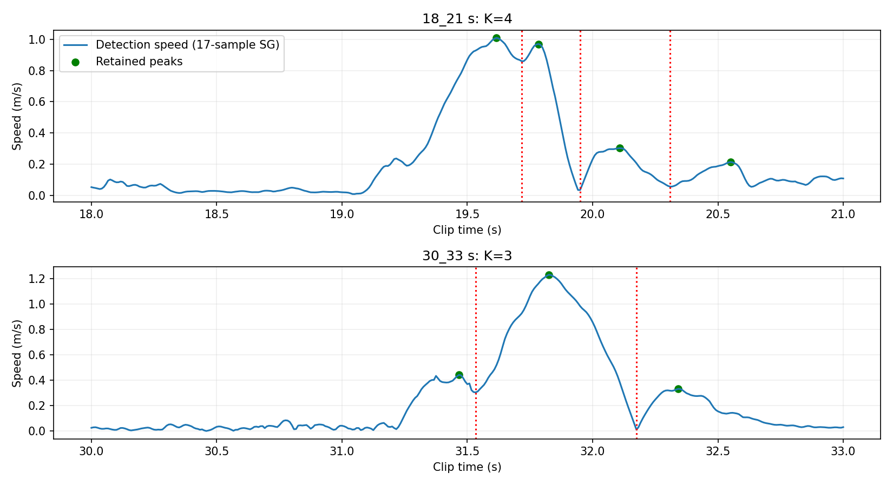
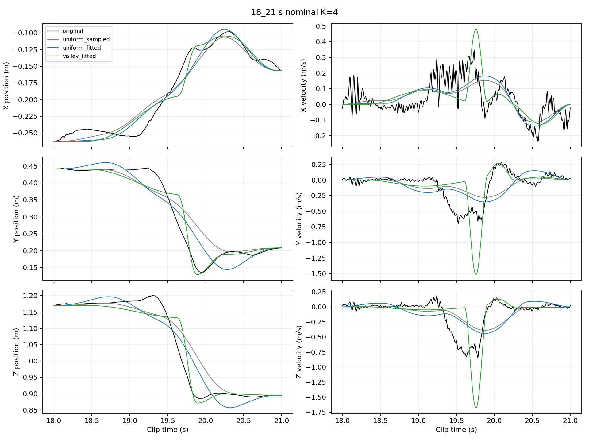
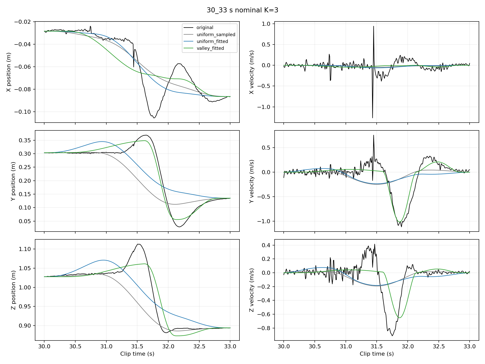
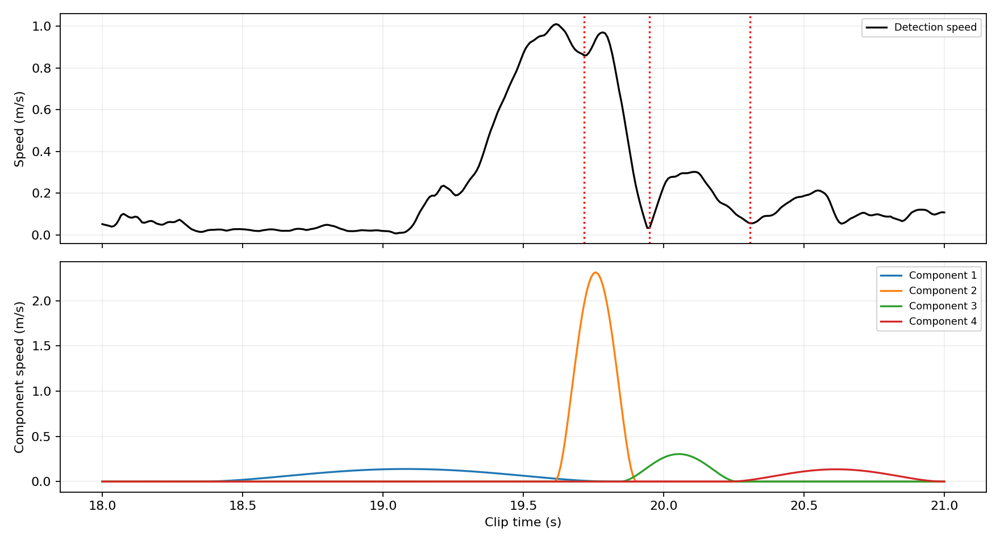
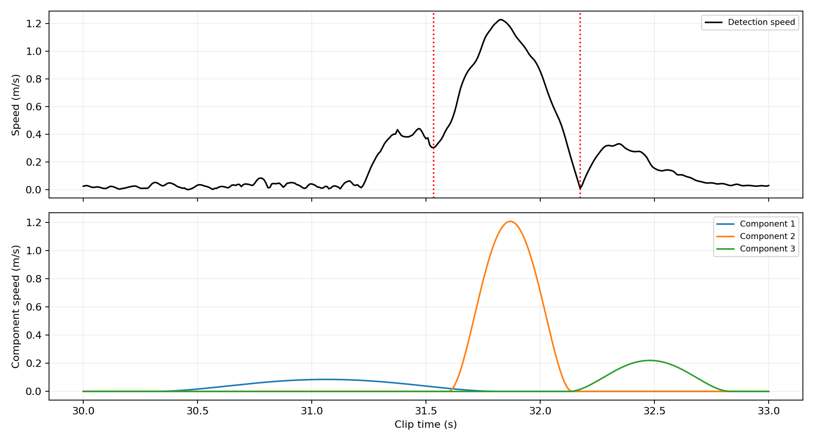
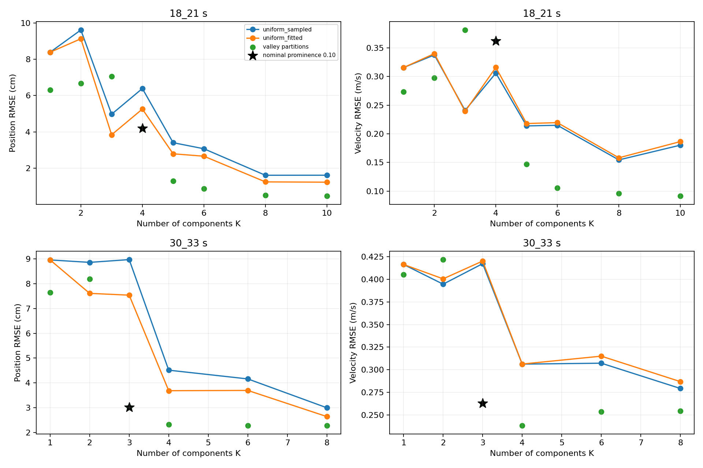

# 教授要求主線與完成結果

完整英文報告已整理成[可編輯 Word 草稿](../report/final_motion_decomposition_report.docx)，包含本頁主結果、敏感度、公式、流程圖與歷史診斷。

這份文件是目前的主線入口。實驗與比較已完成，結果包含明確的負面發現：速率谷值可以提供動作相關的數量與時間候選，但這個簡單規則仍會漏分、過分或錯置分界；不能宣稱已找出唯一正確的 goals 數量。

## 要求對照

| 教授要求 | 本次完成內容 | 限制 |
|---|---|---|
| 同一公開動作片段、一個手腕 | 沿用 AMASS ACCAD 的右手腕，分析同一 clip 的 18–21、30–33 秒 | 本次是兩段各 3 秒，不是全片新方法重建 |
| 目標位置可擬合 | 每次試探時間都重新解固定起終點的線性最小平方法 | 中間累積 goals 不一定是軌跡實際通過的點 |
| 時間來自動作且可擬合 | 以速率峰之間的谷值提出運動區間，開始與結束時間在附近自由擬合，允許重疊 | 時間鄰域是明示的啟發式限制，不是教授指定或人體定律 |
| 決定數量 | 每個保留的速率波提出一個分量；零個峰回退為一個分量 | 濾波與峰突出程度影響數量，不保證真實單元數 |
| 不同數量下的位置、速度誤差 | 擬合不同 prominence 對應的全部不同谷值分區，並在相同 K 比較均勻基準 | 分區也隨 K 改變，曲線不是只改數量的因果實驗 |
| 解釋原因與失敗 | 以下列出主設定、控制比較、參數敏感度、失敗案例 | 不把較小位置誤差等同合理動作分解 |

## 一條可重現的流程

```text
完整 clip 的原始 XYZ 位置
        ↓
估計平滑速度並取速率，再裁出分析區間
        ↓
保留突出速率峰，在相鄰峰之間找最低速率樣本
        ↓
谷值與片段端點形成候選運動區間，區間數就是候選 K
        ↓
每個區間對應一個 minimum-jerk 位移分量
        ↓
在區間邊界附近擬合開始／結束時間，允許相鄰分量重疊
每次時間改變，都重新用線性最小平方法求位移
        ↓
比較重建與原始位置／速度，保存 goals、時間與失敗結果
```

數量不是從最大誤差點新增，也不是從誤差曲線的轉折點選取。舊抵銷懲罰沒有加入本主線，亦未改寫或刪除歷史實驗。

本頁 K 指位移分量數量，也對應 K 個累積 goals；起點另外計算，不包含於 K。

## 具體設定與選擇理由

偵測用完整 clip 的 XYZ 位置，使用 17 樣本、三次多項式的 Savitzky–Golay 導數，再取 XYZ 速度向量長度。120 Hz 下窗長約 0.142 秒，目的是抑制細微波動造成的假峰；這是離線處理。擬合與誤差評估始終使用未平滑位置。

保留 prominence 至少為片段最大偵測速率 10% 的峰，峰間隔至少 0.15 秒。相鄰保留峰之間的最低速率樣本作為候選分界。此規則呼應教授的速率谷值線索，但參數是本實驗的啟發式設定，不宣稱通用或最佳。

為使每個分量仍對應一個候選運動區間，令邊界鄰域尺度 r 為相鄰區間長度的較小值（片段邊緣使用唯一相鄰區間長度）。開始時間可在左邊界 −0.45r 至 +0.20r 之間，結束時間可在右邊界 −0.20r 至 +0.45r 之間，均裁切於分析片段內。0.45／0.20 是讓邊界能移動、相鄰分量能重疊且開始早於結束的啟發式設定；沒有藉由結果調整這些主係數。已完成較窄／原設定／較寬三組[敏感度檢查](timing_bound_sensitivity.md)，誤差大小確實受其影響，不能宣稱係數無關緊要。

初猜使用邊界外延 0.25r；另三組以種子 23 在允許鄰域內產生時間初猜。每次最多 1000 次 nfev。選取成功停止且位置誤差最小的一組，失敗不隱藏。給定時間時線性最小平方可直接求位移；外層只調整時間。固定位置起終點不代表真實片段起終速率為零，但模型在裁切端點的解析速度確實為零，這是限制。

原自由時間、無懲罰對照的第二段 K=3 解，位移長度加總達 212.46 m；雖然重建誤差較低，不能當成人體合理分解。主線使用上述局部時間關聯限制，這兩段名義結果的位移長度加總為 0.594、0.501 m。這是本例的改善，不是消除所有可能抵銷的保證。

## 名義數量與同 K 基準比較

18–21 秒候選分界：18.0000 → 19.7167 → 19.9500 → 20.3083 → 21.0000，K=4。

30–33 秒候選分界：30.0000 → 31.5333 → 32.1750 → 33.0000，K=3。

| 片段 | 方法 | K | 位置 RMSE cm | 速度 RMSE m/s | 最大位置誤差 cm |
|---|---|---:|---:|---:|---:|
| 18–21 秒 | 均勻時間、取樣 goals | 4 | 6.387 | 0.3061 | 18.318 |
| 18–21 秒 | 均勻時間、擬合位移 | 4 | 5.254 | 0.3160 | 13.265 |
| 18–21 秒 | 谷值分區、擬合時間與位移 | 4 | 4.194 | 0.3620 | 14.420 |
| 30–33 秒 | 均勻時間、取樣 goals | 3 | 8.969 | 0.4172 | 24.562 |
| 30–33 秒 | 均勻時間、擬合位移 | 3 | 7.535 | 0.4201 | 17.491 |
| 30–33 秒 | 谷值分區、擬合時間與位移 | 3 | 3.022 | 0.2631 | 8.239 |

**第一段位置 RMSE 下降，速度 RMSE 卻比兩個均勻基準都高，最大位置誤差也高於擬合位移基準。** 因此不能說新方法全面更好；位置目標、錯置候選邊界及局部時間限制均可能影響結果，這裡沒有做消融以分別量化其影響。第二段三項誤差均改善，但 K=3 仍漏掉細節。











## 數量與誤差比較

固定 17 樣本濾波、0.15 秒峰間隔，將 prominence 從 0.01 到 0.40 每次增加 0.01。相同谷值分區只擬合一次，保留所有不同分區，不挑誤差最佳的參數取代名義 0.10。

得到第一段 8 種分區（K=1、2、3、4、5、6、8、10），第二段 6 種（K=1、2、3、4、6、8）。14 種分區各 4 次擬合，共 56 次皆成功停止。相同 K 的均勻取樣與均勻時間擬合基準合計 30 筆比較資料。



點代表不同 prominence 提出的谷值分區，黑星為事先設定的 0.10；不是從這張圖挑出的最佳 K。局部限制的可行域會隨分區改變，因此誤差不保證隨 K 單調下降。偵測參數敏感度另保留窗長 9／17／25、prominence 0.05／0.10／0.20 的完整計數，見摘要。

此外，[無時間鄰域限制的 K=1–12 控制](../results/final_pipeline/errors_vs_count.png)保存三方法各 24 組同 K 比較與 96 筆時間擬合紀錄，其中 4 筆未成功停止，未作有效最佳解候選；每個 K 至少有一筆有效解。它是搜尋與誤差對照，不能把存在巨大抵銷的解當成最終運動單元。

## 公平性與目前可以下的結論

比較控制同一原始資料、相同 K、相同固定位置端點、同一 minimum-jerk 疊加模型與同一位置評估；速度皆用相同 `np.gradient(..., edge_order=2)` 求得。位置 RMSE 是每時刻三維距離平方平均的平方根，速度 RMSE 同理；最大位置誤差是最大三維距離。

非線性時間擬合使用四組初猜，固定時間基準只需一次線性求解；總計算成本不同。主方法還有局部時間鄰域限制，不能將所有差異單獨歸因於谷值或最小平方，也不宣稱全域最優。

本次完成了教授要求的可執行方法、目標位置與時間擬合、動作相關的數量規則、不同 K 誤差與固定間隔比較，以及失敗說明。**這是完成實驗與回應，不是證明數量選擇問題已完全解決。** 主要不足是谷值設定敏感、重疊可能合併速率波、單一彎曲運動可能需要多個分量，以及第一段速度未改善。不能保證教授會接受這個方法。

## 程式與重現

- [目標位置與時間序列](../results/mainline/goals.csv)、[匯出程式](../motion_decomposition/export_mainline_goals.py)。
- [主線執行入口](../motion_decomposition/complete_mainline.py)、[局部時間擬合](../motion_decomposition/valley_fit.py)。
- [無限制控制與資料準備](../motion_decomposition/final_pipeline.py)、[既有線性擬合](../motion_decomposition/fixed_times.py)、[速率谷值規則](../motion_decomposition/goal_count_selection.py)。
- [主線完整摘要與全部初猜](../results/mainline/summary.json)、[同 K 比較表](../results/mainline/metrics.csv)、[數量掃描](../results/mainline/count_sweep.csv)、[擬合陣列](../results/mainline/fits.npz)、[執行設定](../results/mainline/protocol.json)。

```bash
cd research/motion_decomposition
OPENBLAS_NUM_THREADS=1 OMP_NUM_THREADS=1 python3 -m motion_decomposition.final_pipeline
OPENBLAS_NUM_THREADS=1 OMP_NUM_THREADS=1 python3 -m motion_decomposition.complete_mainline
python3 -m motion_decomposition.export_mainline_goals
python3 -m unittest discover -s tests -q
```

檢查：54 項測試通過，包含單分量選數、已知重疊軌跡還原、端點、無效分區，以及敏感度原設定與主線一致。另獨立重算 30 筆主比較與 56 筆局部時間擬合，並核對敏感度的 6 個條件、24 次求解、7 個匯出 goals、CSV／NPZ 與來源雜湊，見[核對結果](../results/timing_bound_sensitivity/audit.json)。這些檢查驗證程式與數值，不能消除方法限制。

## 正式報告採用範圍

主方法固定為本頁的名義設定：17 樣本濾波、10% prominence、0.15 秒峰間隔、時間外延／內縮 0.45／0.20、四組初猜、無抵銷懲罰。以兩段各三秒的原始 XYZ 資料為範圍，起終位置固定。位置以 m、速度以 m/s 保存，表中位置改用 cm 時乘以 100。

| 報告內容 | 唯一採用的資料來源 |
|---|---|
| 名義 K、候選谷值與擬合時間／位移 | results/mainline/summary.json 的 details 中 18_21、30_33 |
| 同 K 基準比較與主結果 | results/mainline/metrics.csv；本頁位置與速度圖 |
| 數量與誤差 | results/mainline/count_sweep.csv；本頁數量圖，明列分區也會變動 |
| 時間鄰域敏感度 | results/timing_bound_sensitivity/metrics.csv；[敏感度說明](timing_bound_sensitivity.md) |
| goals 序列 | results/mainline/goals.csv；累積位置不一定是實際通過點 |
| 自由時間巨大抵銷、舊懲罰與舊選數 | 設計背景或補充，不與主成績混用，不將舊 K=3/4 誤稱本次 K=4/3 |

敏感度檢查完成後保留原設定，未用較寬條件替換主成績。第一段位置／速度對基準的方向在三組設定相同，但數值敏感且時間邊界常被碰觸；第二段亦只有有限範圍的證據。寫作時應同時報告這些限制，不需要為了開始寫報告再擴充其他研究分支。

先前七頁 Word／PDF 與研究總結保留為歷史實驗；它們未包含這次無懲罰、局部時間關聯主線。新版完整 Word 已在頁首連結，本頁保留為可追溯的實驗說明。
