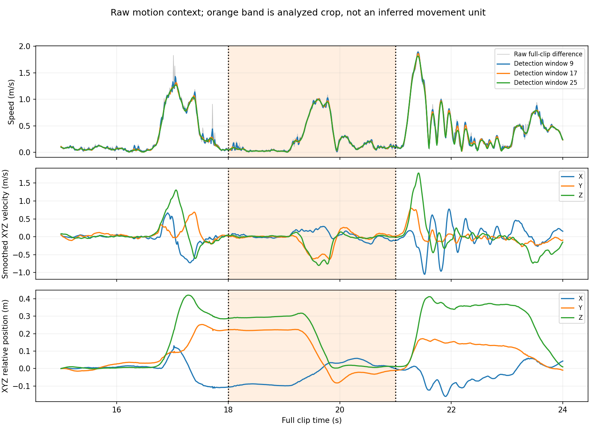
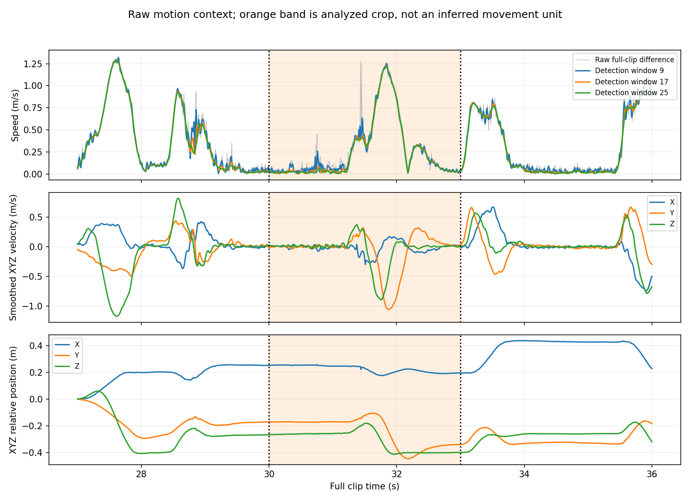
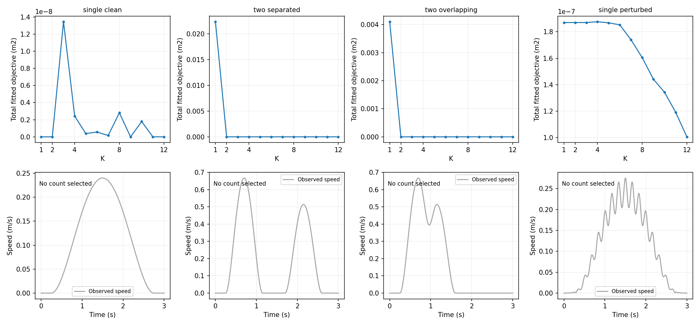

# Movement units 的結構驗證

本輪先固定目前的方法，檢查其結構恢復能力與真實資料脈絡，不調整權重、不加入新時間限制，也不把原先的 3/4 個 goals 當必須維持的答案。這份記錄與既有七頁成果報告分開；該報告尚未包含本輪新增發現。

## 預先固定的檢查

四個案例皆使用 120 Hz、0–3 秒、361 點，沿用原本位置目標、固定端點、lambda=1e-6、L=0.3 m、最短持續時間 2/120 秒、max_nfev=1000、seed=23 及十組初猜。每個案例測 K=1–12；K=1 的十個相同初猜只算一次。

| 案例 | 已知生成設定 | 可以如何判讀 |
|---|---|---|
| 單一乾淨分量 | 0.25–2.75 秒，位移 (0.30, 0.10, 0.05) m | 檢查最簡單 K=1 是否能被選出 |
| 兩個分離分量 | 0.25–1.15、1.70–2.60 秒，三維非平行位移 | 檢查容易區分的兩個分量 |
| 兩個重疊分量 | 相同位移與各 0.9 秒時長，改為 0.25–1.15、0.70–1.60 秒 | 檢查重疊與同時反向貢獻的影響 |
| 單分量加波動 | 單分量基底加上 X 向 6 Hz、最高 1 mm 的包絡波動 | 已知基底是一分量，但不宣稱受擾訊號的精確真值仍是 K=1 |

合計 480 筆主流程紀錄，444 次不同初猜求解與 36 筆 K=1 重用。額外四次真實時間初猜的診斷，以及已知時間下的乾淨資料線性求解，均不加入主要選解池。這些有真值資訊的控制用來區分搜尋限制、代價偏差與選數規則問題。

乾淨案例的數量以最小數學表示解讀：單一非零分量至少需要一個；兩個案例的位移向量非平行，且各自有單獨作用的時間，因此合成方向會改變，一個固定方向的分量無法精確表示。這不保證全部參數在任何資料條件下唯一，也不是人體神經控制的真值。任意拆分可以得到較多的等價分量，正是需要另行檢查的冗餘表示。

原轉折規則照常檢查上限 6、8、10、12；若不單調、平坦或沒有有效解，保留無法選數的結果，不修改曲線。參數誤差以連續數值呈現，不在看到結果後才定義恢復成功門檻。

## 先已確認的結構問題

**目前規則無法選 K=1。** 它只在曲線內部點找最大距離，因此輸出只能是 2 到上限減一，或回報無法選擇。這是規則本身的限制，並非人體資料不足造成。

**反向懲罰受等價分量拆分影響。** 對重疊案例，把每個原分量拆成 m 個相同開始／結束時間、位移各為原本 1/m 的副本，合成軌跡與速度完全不變。但原本的負內積平方成對懲罰，會降為原值的 1/m²。

| 每個分量拆成幾份 | 表示的 K | 反向懲罰 | 乾淨目標總代價 |
|---:|---:|---:|---:|
| 1 | 2 | 0.03966319 | 3.9663e-8 |
| 2 | 4 | 0.00991580 | 9.9158e-9 |
| 4 | 8 | 0.00247895 | 2.4789e-9 |

三條軌跡的數值差異低於 1e-14 m。這證明不同 K 的總代價可能因表示方式改變，而不是更好地解釋了運動。它不證明先前的所選解確實用了這種拆分，也不使位置／速度比較數值失效；但不能再把此代價當作不受分量表示影響的結構證據。

這個問題來自本專案自訂的成對負內積平方代價，不是教授要求，也不能直接歸因於原論文。原先的有無懲罰實驗仍支持它有助於控制某些巨大抵銷案例；跨 K 作結構選數則需要另外滿足一致性條件。

另外，兩個完全相同時間基底的分量可以合併成一個，已用代數及數值確認。因此生成時放入兩個，不代表軌跡一定提供足夠資訊恢復兩個。

## 真實資料前後脈絡

橘色部分為原先選取的三秒片段，不是新偵測出的 movement unit。速率使用全 clip 計算，另外顯示 9、17、25 點微分濾波；下方提供 XYZ 速度和相對位置，協助辨認運動變化，不直接標註動作意圖。

| 片段 | 原始全 clip 差分起／終速率 m/s | 17 點平滑起／終速率 m/s |
|---|---|---|
| 18–21 秒 | 0.03169 / 0.07311 | 0.05252 / 0.10829 |
| 30–33 秒 | 0.04709 / 0.05506 | 0.02598 / 0.03107 |

兩段大致涵蓋明顯運動起伏與較慢部分，但邊界不是精確靜止。這本身不證明截段錯誤或剩餘速率都是噪聲；目前模型在邊界所有分量尚未開始或已完成，因而強迫解析速度為零，須將這個假設與固定位置端點分開看待。

## 完成結果

已完成 480 筆主流程紀錄（444 次不同求解、36 筆相同 K=1 初始化重用）。獨立重算已核對全部紀錄、48 組最佳解、16 次選數決策、參數配對、等價拆分與來源雜湊。原有 49 項數值測試通過。

### 自動選數是否找回已知結構？

| 案例 | 上限 6 | 上限 8 | 上限 10 | 上限 12 |
|---|---:|---:|---:|---:|
| 單一乾淨分量 | 未選出 | 未選出 | 未選出 | 未選出 |
| 兩個分離分量 | 2 | 2 | 未選出 | 未選出 |
| 兩個重疊分量 | 2 | 2 | 未選出 | 未選出 |
| 單一分量加擾動 | 未選出 | 未選出 | 未選出 | 未選出 |

所有「未選出」的直接原因都是成本曲線未通過現有單調性檢查；沒有事後套用包絡線或平滑。這代表程序拒絕選數，不代表它選到了錯誤數量，也不是經校準的不確定度。部分成本上升的絕對量很小，不能據此說軌跡重建全面失敗。然而，即使移除這個影響，目前只取內部彎折點的規則仍不能選 K=1，屬於設計缺口。

圖下排沒有擬合線，是因為上限 12 時程序未選數，而非沒有執行擬合。上排為包含懲罰的總目標值，不是純位置誤差。

### 已知分量數量時，擬合核心是否能還原？

| 案例與使用 K | 位置 RMSE | 最大開始／結束時間差 | 最大位移向量差 |
|---|---:|---:|---:|
| 單一乾淨，K=1 | 3.65e-12 m | 8.96e-11／8.18e-11 s | 0 m |
| 分離，K=2 | 1.17e-16 m | 5.55e-17／2.22e-16 s | 3.10e-17 m |
| 重疊，K=2 | 0.0127 mm | 0.282／0.211 ms | 0.103 mm |
| 加擾動，K=1 | 對觀測值 0.432 mm | 對乾淨基底約 0.000531／0.000531 ms | 0 m |

這些是主流程在已知基底 K 下的最佳解，並非自動選數成功的證據。加擾動訊號沒有宣稱精確的 K=1 真值；其 K=1 重建與乾淨基底的軌跡差異僅約 2.23e-8 m。

另以真實時間初始化的四組診斷全部收斂，但未放入主流程候選池。重疊案例即使從真實時間出發，也移到幾乎相同的有偏解（位置 RMSE 0.0127 mm）；固定真實時間、無懲罰的線性最小平方法可達約 1.14e-16 m。這支持本例的小偏差來自懲罰目標的取捨，不能全歸因於初始化失敗。此結論只涵蓋這些受控案例。

## 對目前研究的意義與下一項修正

已知 K 的擬合核心在這些案例表現良好；完整選數流程尚未通過結構驗證。真實片段的 3／4 分量仍是先前程序的輸出，其位置／速度比較數值仍有效，但不能直接稱為已確認的 movement units。先前的 7 頁報告尚未包含本輪驗證，應搭配本頁閱讀。

下一項方法修正先處理兩個已證實的缺口：讓選數規則能合理接受單一分量，以及避免只靠同向重複拆分就降低抵銷懲罰。還要明確處理不同 K 的求解品質與非單調成本，不能直接把局部求解誤差當成動作結構。這不是要求對任意分解都施加相同懲罰；真正的反向抵銷仍應能被區分。

本輪不新增時間先驗、不更改既有方法，也不宣稱已找到最佳懲罰公式。修正後必須用同一組受控案例重驗，再評估真實片段；單靠這些合成案例亦不能證明人體的真實神經動作單元。

## 重現與資料

程式：[validate_movement_structure.py](../motion_decomposition/validate_movement_structure.py)。在研究目錄執行 `OPENBLAS_NUM_THREADS=1 OMP_NUM_THREADS=1 python3 -m motion_decomposition.validate_movement_structure --workers 6`，可從本機檢查點續跑。

資料：[設定與來源雜湊](../results/movement_unit_validation/protocol.json)、[前置檢查及完整片段脈絡](../results/movement_unit_validation/preflight.json)、[完整摘要](../results/movement_unit_validation/summary.json)、[逐次紀錄](../results/movement_unit_validation/runs.csv)、[擬合陣列](../results/movement_unit_validation/fits.npz)。checkpoints/ 為本機重複快取，未納入 Git。
