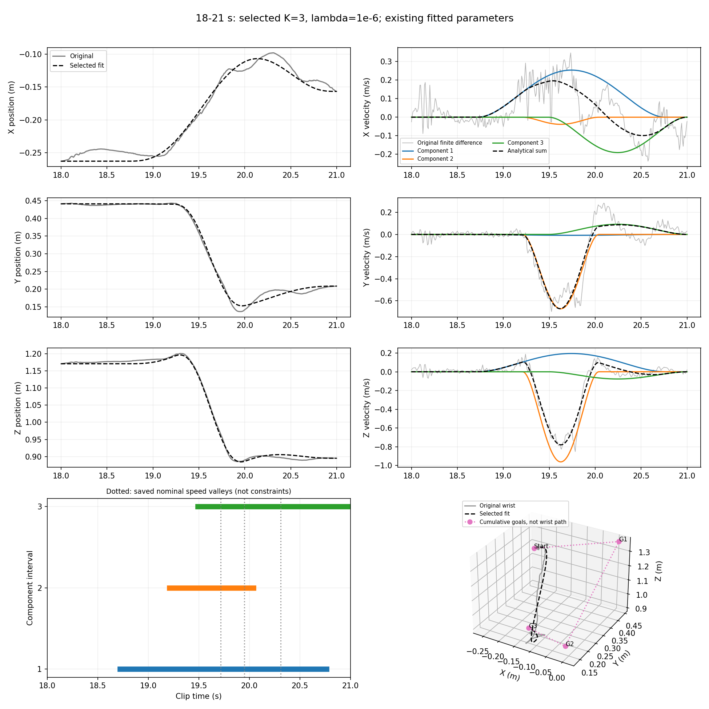
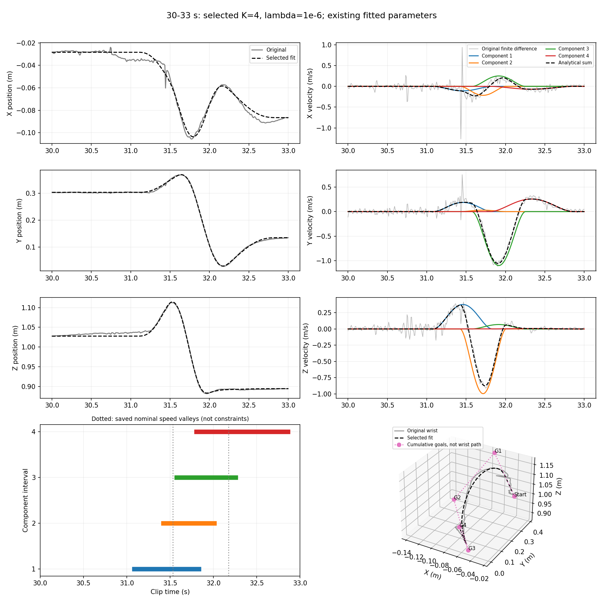

# 本輪研究總結

目前主線與最新結果：[教授要求主線與完成結果](mainline_results.md)。已完成速率谷值數量提案、局部時間擬合、線性最小平方位置擬合，以及同 K 固定間隔與數量比較。未使用舊抵銷懲罰或彎折選數。第一段速度誤差未改善、數量對參數敏感，均已明列；不宣稱得到唯一正確的動作單元數。

以下保留先前階段紀錄。既有 Word／PDF 未包含這次新主線，最新報告請讀上述連結。

最新進度：已完成 [movement units 結構驗證](movement_unit_validation.md)。已知 K 的擬合可還原受控案例，但自動選數尚未通過驗證；發現 K=1 無法被選中、重複拆分可降低自訂抵銷懲罰兩項設計缺口。既有 3／4 分量與報告應搭配驗證結果解讀；7 頁報告尚未包含本輪驗證。

這份文件是目前的主要閱讀入口。先前逐步實驗保留為證據與重現資料，本輪不再擴增方法或提高數量上限。以下結論來自同一個 AMASS/ACCAD 動作的右手腕、兩個三秒片段，不代表完整動作片段或全身轉換已驗證。

## 結論先說

交付收尾已補上[同條件固定間隔比較](baseline_comparison.md)，並產生獨立的七頁英文 [Word 報告](../report/fitting_and_goal_selection_report.docx)與 [PDF 報告](../report/fitting_and_goal_selection_report.pdf)。下文仍保留兩段資料、搜尋預算與分解不唯一等限制。

目前已完成可執行的位置／時間擬合，以及一個有有限實驗支持的 goals 數量選擇原型：在本輪明定的懲罰條件與候選範圍下，轉折規則為第一段選三個、第二段選四個。測試上限為 8、10、12 時，這兩個選數一致。

它是精簡近似的候選結果，不是最低誤差解，也不是人體真實動作單元數的證明。第一段三分量在十組既有初猜中一致；第二段四分量仍有兩種不同分解。這些限制已查明，本輪工作可以在這個有界結論下收束，不必為了宣稱完美而繼續開實驗。

## 方法是一條流程

```text
原始右手腕位置
  → 對 K=1–12 分別建立十組時間初猜
  → 擬合分量開始／結束時間與位移，固定起終點
  → 每個 K 選有效結果中總代價最低者
  → 從代價—K 曲線按既有轉折規則選候選 K
  → 檢查候選重建、分量安排與不同初猜的差異
```

每個 K 使用五組均勻時間初猜與五組速度低點初猜，後者來自原始差分速率在時間槽中的低點。這是初始化規則，最終時間仍由擬合改變，不是固定時間分段。K=1 的十筆初始化完全相同，只能算一個不同初猜。

軌跡仍用原本的重疊 minimum-jerk 位移表示：`p_hat(t)=p0+sum_i S_i(t)d_i`；累積 goal 為 `p0+cumsum(d_i)`。開始位置固定，所有位移總和等於觀測終點減起點。**因此中間 goals 是擬合位移形成的目標，不再直接抄原軌跡的位置；重疊時也不保證實際經過每個 goal。**

已實作固定時間下、固定端點的線性最小平方法。加上自訂反向貢獻懲罰後，時間與位移使用共同非線性求解；此時不能說最終解仍只是普通線性最小平方。主候選使用 lambda=1e-6、L=0.3 m，是本研究的暫定控制條件，不是已證明最佳的權重或人體標準。

轉折規則把 K 與代價正規化，再取距兩端連線最遠的內部點。主代價是位置 MSE 加反向貢獻懲罰，不是位置 RMSE；速度目前用於獨立評估，未直接放入目標函數。這是受 Liao & Kirsch (2014) 啟發的改用版本，原文的速度擬合及代價不同，不能聲稱完整重現。

## 選數與精度的結果

| 測試上限 | 第一段選 K | 第二段選 K |
|---:|---:|---:|
| 6 | 3 | 2 |
| 8 | 3 | 4 |
| 10 | 3 | 4 |
| 12 | 3 | 4 |

上限六曾影響第二段的選擇；延伸後得到較一致的候選。這仍只涵蓋本次範圍，不保證所有上限皆一致，也未檢查新動作資料。

| 片段／解 | 位置 RMSE | 速度 RMSE | 最大位置誤差 |
|---|---:|---:|---:|
| 第一段，候選 K=3 | 1.414 cm | 0.1223 m/s | 2.467 cm |
| 第一段，K=12 精度參考 | 0.179 cm | 0.0658 m/s | 詳見原數據 |
| 第二段，候選 K=4 | 0.618 cm | 0.1310 m/s | 1.570 cm |
| 第二段，K=12 精度參考 | 0.154 cm | 0.1227 m/s | 詳見原數據 |

較少 goals 的好處是較精簡，不是誤差更小。第二段四分量之後的速度改善較有限；第一段則仍有較多速度細節沒有被三分量保留。不能在沒有精度需求的情況下保證這些誤差一定足夠。

## 第一段：三分量穩定，但仍是重疊描述



左邊三列比較原始與重建位置；右邊比較原始差分速度、各分量解析速度與它們的向量和。正式速度 RMSE 對原始與重建都使用同一有限差分公式；圖中的解析速度用於說明分量，兩者用途不同。底部為時間區間與三維 goals。

| 分量 | 開始／結束時間（秒） | 位移向量 XYZ（m） | 可由模型直接說明的作用 |
|---:|---|---|---|
| 1 | 18.720–20.762 | (+0.277, −0.009, +0.212) | 較長的正 X、正 Z 貢獻 |
| 2 | 19.210–20.040 | (−0.017, −0.297, −0.426) | 較短、主要負 Y 與負 Z 的快速貢獻 |
| 3 | 19.491–21.000 | (−0.154, +0.074, −0.062) | 後段負 X、正 Y 的回調貢獻 |

三個區間重疊，不是依序三個互不相干的動作。主要位置變化有被保留，但 X 向前段變化、峰值與尾段細節仍有偏差。最大位置誤差出現在約 20.317 秒。

各分量位移模長約 0.349、0.520、0.181 m，總和約 1.050 m，未出現數百公尺的巨大分量；但仍存在同時反向貢獻，不能說抵銷已完全消除。這些方向是腕部三維幾何貢獻，沒有將分量直接命名為某個人體動作意圖。

三維圖中，中間 goals 與重建軌跡的最近保存樣本距離約 29.8、12.3 cm。這不是程式把原軌跡抄錯，而是相加模型允許的結果；它也提醒我們，不能把這份數學分解直接描述為實際經過的途經點或已驗證的可執行人體姿勢。

## 第二段：四分量擬合較好，但分解不唯一



| 分量 | 開始／結束時間（秒） | 位移向量 XYZ（m） | 可由模型直接說明的作用 |
|---:|---|---|---|
| 1 | 31.085–31.832 | (−0.043, +0.075, +0.150) | 前段負 X、正 Y、正 Z 貢獻 |
| 2 | 31.423–32.009 | (−0.067, +0.009, −0.311) | 主要負 Z 下降貢獻 |
| 3 | 31.575–32.255 | (+0.091, −0.398, +0.025) | 主要負 Y、正 X 貢獻 |
| 4 | 31.801–32.861 | (−0.039, +0.145, +0.004) | 後段以正 Y 為主的回調貢獻 |

主要起伏與回調有被保留，前段緩慢變化及短促速度起伏仍有偏差，最大位置誤差約在 31.442 秒。四個位移模長總和約 1.051 m，仍有同時反向貢獻。

兩張圖底部的灰色虛線是先前 B 方法的名義速度谷底，只作對照，不是這些解的固定分界，也不是所選初猜的原始全部時間。擬合區間可跨過谷底；不能因為不貼齊谷底就判定錯誤，也不能因為貼齊就宣稱符合人體動作單元。

## 初猜敏感度已一併查完

使用已保存的十組初猜，先依分量解析三維速度，在全部 3! 或 4! 個排列中配對，避免把編號互換當成不同分解。這是數值配對，不是人體動作標註。

| 檢查 | 第一段 K=3 | 第二段 K=4 |
|---|---:|---:|
| 有效初猜數 | 10/10 | 10/10 |
| 位置 RMSE 範圍 | 約 1.414 cm，幾乎相同 | 0.618–0.691 cm |
| 相對所選解，最大分量結束時間差 | 約 0.00000076 s | 約 1.142 s |
| 最大分量位移向量差 | 約 0.00000049 m | 約 0.331 m |

第一段十組在數值上幾乎一致；這是本次初猜池的穩定證據，非唯一性定理。第二段第 0、3、4 組初猜得到另一種分解，其餘七組接近所選解；不是七個獨立動作參與者，也不能解讀成一般成功機率 70%。另一種分解的代價更高，所以明定的最低代價規則仍能選出一個結果，但不能說所有初猜得到同一個動作單元安排。

## 對教授要求的對照

| 要求 | 現在可以如何陳述 |
|---|---|
| 使用同一公開動作及一隻手腕 | 已使用同一 clip 的右手腕；新研究目前只驗證兩段短片段 |
| 使用重疊 minimum jerk | 保持相加模型，可重疊，不必等上一個 goal 到達 |
| goal 位置可擬合，時間也應求得 | 已實作線性位移擬合及時間／位移共同最佳化；中間位置不再直接抄原軌跡 |
| 從動作決定數量 | 已有按曲線選 K 的可執行原型及上限敏感度結果，候選為 3/4；適用性有限 |
| 不能只追逐誤差，要考慮動作單元 | 已檢查分量方向、時間與速度谷底及初猜差異；尚不足以證明分量就是人體動作單元 |
| 展示數量與位置／速度誤差關係 | 已有 K=1–12 曲線及失敗紀錄 |
| 與固定間隔方法比較 | 已補上同片段、同 K、同端點與同評估的均勻時間取樣基準，以及使用相同代價的均勻時間位移擬合控制；搜尋預算仍不同，並非完整 clip 的直接裁切比較 |
| 說明選擇理由及失敗處 | 本文已整理精簡近似的理由、未保留細節、分解不唯一及假設限制 |

因此可以報告「已得到新的擬合與初步選數結果」，不能報告「所有要求已完整解決」。固定起終點與反向懲罰是我們的研究設定，教授沒有明確指定它們；不把完整人體力學、全身或學習模型擅自加入這次完成條件。

## 本輪收束範圍

本輪的選數觀察、候選重建、分量安排與初猜檢查已完成。保留 K=3/4 作為原轉折規則在明定條件下的精簡近似候選；不為得到唯一數字而繼續提高 K、調整門檻或增加新方法。對第二段分解不唯一、兩段短資料及基準比較差異，直接作為限制呈現。

固定間隔收尾比較共 72 筆結果，新增的 24 組固定時間位移擬合均成功。在候選數量下，相對均勻時間、擬合位移，第一段位置 RMSE 由 3.837 降至 1.414 cm，第二段由 3.686 降至 0.618 cm；速度 RMSE 分別由 0.2393／0.3063 降至 0.1223／0.1310 m/s。比較控制資料、K 與代價，沒有控制相同總搜尋成本，因此不能將改善全部歸因於單一因素。

本機研究報告已編排完成，舊兩份 PDF 沒有覆寫；沒有推送程式或寄信。這完成本輪已界定的實驗與交付整理，不代表已證明人體動作單元、全片段或跨動作適用性。

## 重現與證據入口

本次整理只讀已有數據，沒有新擬合；使用 `python3 -m motion_decomposition.review_candidates` 重現。數據與圖：[候選檢查摘要](../results/candidate_review/summary.json)、[分量與 goals](../results/candidate_review/components.csv)、[十組初猜比較](../results/candidate_review/runs_vs_selected.csv)。

原始比較：[K=1–12 結果與限制](fitting_step14_extended_counts.md)。其餘原型與診斷收在[實驗索引](experiment_index.md)，不必按步驟重新閱讀。文獻與實作差異見 [References](references.md)。

本次核對 20 個既有候選解的重建與誤差、七個累積 goals、時間／位移配對及來源雜湊；49 項既有測試通過，兩張總覽圖已檢查。先前 K=1–12 的 480 筆紀錄未改動。
