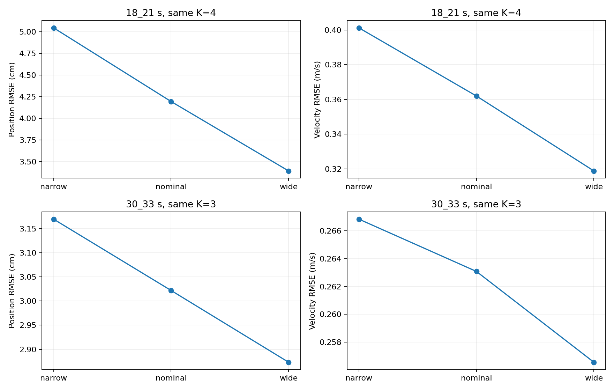
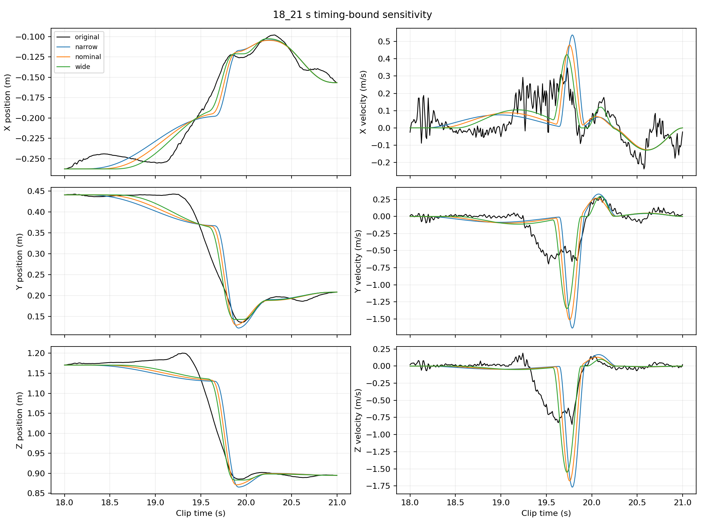
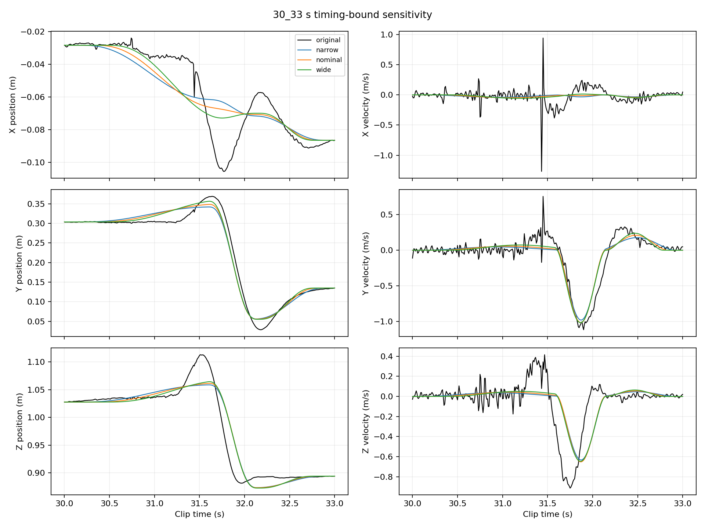

# 時間鄰域係數說明與敏感度檢查

這項收尾只改變開始、結束時間的搜尋範圍，固定原始資料、谷值、分量數量、目標函數、求解預算與選解規則。結論是：係數對第一段重建誤差有明顯影響，不能宣稱任意選擇都一樣；但相對均勻基準的主要位置／速度結論在本次三組設定下相同。原設定保留為主結果，不事後改用得分最佳設定。

## 0.45 和 0.20 是什麼

每個分量對應一個候選運動區間，左邊界記為 L，右邊界記為 R。這些邊界來自速率谷值，並非已知的真正起終時間。

邊界尺度 r 是該邊界左右兩個候選區間長度的較小值；片段的最外邊界只有一個相鄰區間，就使用其長度。左、右邊界可有不同 r，分別記為 rL、rR。

| 要擬合的時間 | 允許範圍 | 係數意義 |
|---|---|---|
| 開始 a | L − 0.45 rL 到 L + 0.20 rL | 可以提早最多 45% 邊界尺度，或延後最多 20% |
| 結束 b | R − 0.20 rR 到 R + 0.45 rR | 可以提早最多 20% 邊界尺度，或延後最多 45% |

兩者都限制在分析片段內。因此 0.45／0.20 是無單位的比例，不是秒數、位置誤差、速度門檻或懲罰權重。

例如某個內部分量的 L=2 秒、R=3 秒，兩個邊界尺度恰好都是 0.5 秒，而且片段端點不會截斷範圍：

- 開始可在 2 − 0.45×0.5 = 1.775 秒到 2 + 0.20×0.5 = 2.100 秒之間擬合。
- 結束可在 3 − 0.20×0.5 = 2.900 秒到 3 + 0.45×0.5 = 3.225 秒之間擬合。

0.45 控制往候選區間外延伸的程度，讓相鄰分量可以重疊；0.20 控制往區間內縮的程度，讓擬合可以延後開始、提早結束。它們只限定可搜尋範圍，最後的時間由擬合決定，不是直接設成範圍端點。

初始外延 0.25 是另一個設定：它只決定第一組初猜，與可行範圍的 0.45／0.20 不同。這些比例都不是教授指定、原論文證明或人體通用常數。

## 比較如何控制

| 設定 | 往區間外延伸比例 | 往區間內縮比例 |
|---|---:|---:|
| 較窄 | 0.30 | 0.10 |
| 原設定 | 0.45 | 0.20 |
| 較寬 | 0.60 | 0.30 |

這三組在新實驗開始前寫入 protocol.json，較窄範圍包含在原範圍內，原範圍包含在較寬範圍內。沒有搜尋哪一組最適合後再當作事前設定。

固定 18–21 秒 K=4 與 30–33 秒 K=3，以及名義 17 樣本濾波、10% prominence、0.15 秒峰間隔。數量與谷值不隨本實驗改變，因此這是時間鄰域敏感度，不是數量選擇穩健性的證明。

每個條件四組初猜、seed=23、max_nfev=1000。第一組初猜在三個條件完全相同（外延 0.25r），另三組使用相同的正規化隨機數映射到各自範圍，並非相同的絕對時間。目標都是未平滑 XYZ 位置平方誤差；每次時間變動都重新求固定位置端點的線性最小平方位移，不加抵銷懲罰。

## 結果

共六個條件、24 次求解皆成功停止。原設定兩個最佳結果與既有主線重建相同至 1e-10 m 的核對容差。

| 片段 | 設定 | K | 位置 RMSE cm | 速度 RMSE m/s | 最大位置誤差 cm | 位移長度加總 m | 貼近時間範圍的參數 |
|---|---|---:|---:|---:|---:|---:|---:|
| 18–21 秒 | 較窄 | 4 | 5.046 | 0.4012 | 17.290 | 0.610 | 7 / 8 |
| 18–21 秒 | 原設定 | 4 | 4.194 | 0.3620 | 14.420 | 0.594 | 6 / 8 |
| 18–21 秒 | 較寬 | 4 | 3.391 | 0.3189 | 11.401 | 0.563 | 5 / 8 |
| 30–33 秒 | 較窄 | 3 | 3.169 | 0.2668 | 8.422 | 0.484 | 4 / 6 |
| 30–33 秒 | 原設定 | 3 | 3.022 | 0.2631 | 8.239 | 0.501 | 3 / 6 |
| 30–33 秒 | 較寬 | 3 | 2.873 | 0.2566 | 8.000 | 0.529 | 2 / 6 |

「貼近」定義為參數至任一邊界距離不超過其可行區間寬度的 1e-6；包含片段端點限制。這是診斷數字，不代表只有鄰域係數造成的限制，也不等於求解失敗。







## 報告應如何解讀

第一段較寬範圍的位置 RMSE 比原設定低約 19%，第二段低約 5%。許多時間參數靠近可行範圍邊界，說明限制正在影響擬合，不能寫成「結果不受係數影響」。較寬條件有更多可行時間；本例成本下降不意外，但有限次非線性求解本身不保證找出各條件全域最佳解。

相對相同 K 的固定時間擬合基準，第一段三組位置 RMSE 都較小、速度 RMSE 都較大；相對均勻取樣 goals 基準也同樣如此。第二段三組的位置與速度 RMSE 都低於兩種均勻基準。這些主要方向在所測範圍內一致，但最大位置誤差的比較會隨設定改變，不能將所有指標概括為穩健。

不能因較寬條件誤差較小，就說 0.60／0.30 是最佳設定；目前沒有外部精度需求、獨立驗證資料或係數選擇準則。主報告保留 0.45／0.20，並將本表列為參數敏感度。自由時間對照中的巨大抵銷也不能只靠放寬／收緊時間區間就宣稱全面解決。

本次只同時比較三組「外延／內縮」配對，沒有分別隔離兩個係數的影響，亦未對全部數量分區、其他 clip 或其他受試者重做。因此這是有限範圍的必要檢查，不是生理合理性或通用性的證明。

## 正式報告可用的英文敘述

I associated each component with a candidate speed lobe and allowed its onset and completion to vary near the detected boundaries. These neighborhoods are heuristic constraints intended to preserve the association while allowing overlap, rather than physiological limits. I compared narrower, nominal, and wider neighborhoods while keeping the detected counts and boundaries fixed. The nominal results were reproduced. Wider neighborhoods reduced position RMSE in both windows, showing that the constraints affect the reconstruction. Across the three tested settings, position RMSE remained below both uniform baselines in both windows; velocity RMSE remained higher in the first window and lower in the second. I retained the nominal setting for the main comparison and report this sensitivity rather than claiming an optimal neighborhood size.

## 重現與證據

```bash
cd research/motion_decomposition
OPENBLAS_NUM_THREADS=1 OMP_NUM_THREADS=1 python3 -m motion_decomposition.timing_bound_sensitivity
python3 -m motion_decomposition.audit_report_evidence
python3 -m unittest discover -s tests -q
```

- [實驗程式](../motion_decomposition/timing_bound_sensitivity.py)、[設定](../results/timing_bound_sensitivity/protocol.json)。
- [完整結果與各次擬合](../results/timing_bound_sensitivity/summary.json)、[比較表](../results/timing_bound_sensitivity/metrics.csv)、[求解狀態](../results/timing_bound_sensitivity/runs.csv)、[擬合陣列](../results/timing_bound_sensitivity/fits.npz)。
- [獨立一致性核對程式](../motion_decomposition/audit_report_evidence.py)、[核對結果與輸出雜湊](../results/timing_bound_sensitivity/audit.json)。
