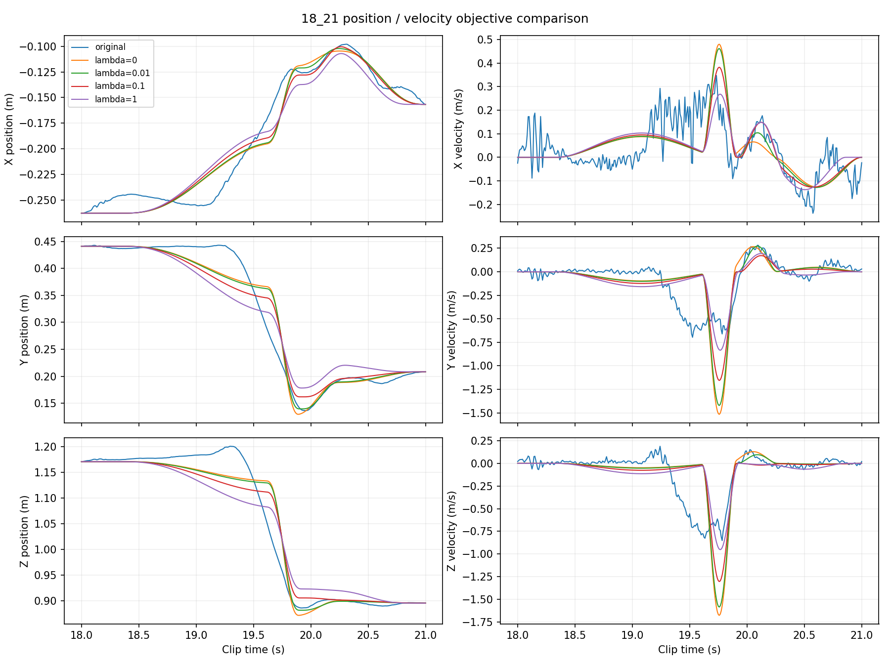
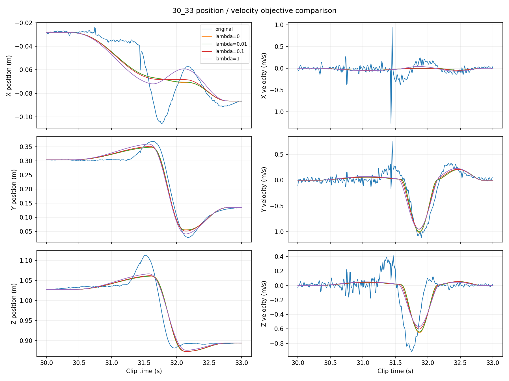

# 位置與速度聯合擬合：獨立延伸實驗

本實驗未取代位置擬合主線；精簡結果已列入正式報告第 4.4 節。本頁保留完整設定與比較圖。

## 目標函數

```text
J = position_RMSE²/L² + lambda * velocity_RMSE²/V²
L = 原始三維位置相對其平均位置的 RMS 距離
V = 原始三維速度的 RMS 大小
```

兩尺度每段從原始資料計算一次，各權重共用，最低取 1e-12 防止除零。正規化避免直接相加不同單位，並不證明感知重要性相等。lambda=1 是正規化平方誤差同權，不代表實際誤差或改善相等。探索權重預先設定為 0、0.01、0.1、1，未依結果選定最佳權重。

速度用原始位置的 `numpy.gradient(..., edge_order=2)`，與原評估一致；不是平滑的偵測速率，也不是獨立量測資料。

## 求解

固定時間、消去最後位移以維持端點後，原位置方程為 F D ≈ Y。令 G 為數值微分，聯合線性最小平方為：

```text
[ F/L               ] D ≈ [ Y/L               ]
[ sqrt(lambda)*GF/V ]     [ sqrt(lambda)*GY/V ]
```

每次外層調整時間，都重新求聯合最優位移。內外層使用同一目標；零權重直接沿用舊線性求解。選解依成功停止且端點有效的候選中最低聯合目標，不再依位置誤差挑解。跨權重 J 的定義不同，不比較其大小選權重。

控制條件：相同兩段原始資料、原名義 K=4/3 與候選分界、0.45/0.20 時間限制、四組相同初猜、種子23、每次最多1000 nfev、固定位置端點、無抵銷懲罰。

## 結果

| 片段 | lambda | 位置 RMSE cm | 速度 RMSE m/s | 最大位置誤差 cm |
|---|---:|---:|---:|---:|
| 18–21 s | 0 | 4.194 | 0.3620 | 14.420 |
| 18–21 s | 0.01 | 4.211 | 0.3436 | 13.981 |
| 18–21 s | 0.1 | 4.542 | 0.3040 | 11.909 |
| 18–21 s | 1 | 5.627 | 0.2768 | 13.573 |
| 30–33 s | 0 | 3.022 | 0.2631 | 8.239 |
| 30–33 s | 0.01 | 3.022 | 0.2617 | 8.236 |
| 30–33 s | 0.1 | 3.040 | 0.2570 | 8.259 |
| 30–33 s | 1 | 3.177 | 0.2520 | 8.638 |

32 次起始搜尋皆成功停止。零權重與原主線一致至數值求解差異，metrics 保留實際差值。本次兩段速度 RMSE 隨權重增加下降，位置 RMSE 上升；最大位置誤差沒有必然單調改善。

第一段 lambda=0.1 的位置和速度 RMSE 均低於原兩個均勻基準，但位置誤差高於位置單目標版本。這是此片段的事後觀察，不代表 0.1 通用最佳。lambda=1 的第一段位置誤差高於均勻時間擬合位移基準。第二段速度收益較小。結果支持速度改善與位置取捨，不能宣稱所有指標全面改善。





## 限制與重現

原始位置微分會放大噪聲，速度目標也可能擬合噪聲。模型端點解析速度為零的限制仍在。K、分區固定，未研究聯合目標對選數的影響。未保證生理動作單元、無抵銷、動力學合理性或全域最優。只有同一 clip 兩段訓練內結果，沒有跨片段權重驗證。

在 WSL 專案根目錄執行：

```bash
OPENBLAS_NUM_THREADS=1 OMP_NUM_THREADS=1 python3 -m motion_decomposition.velocity_objective
python3 -m unittest discover -s tests -q
```

[實作](../motion_decomposition/velocity_objective.py) · [測試](../tests/test_velocity_objective.py) · [設定](../results/velocity_objective/protocol.json) · [數據](../results/velocity_objective/metrics.csv) · [全部初猜](../results/velocity_objective/summary.json) · [陣列](../results/velocity_objective/fits.npz)

原主線未覆寫，來源 SHA256 記於 protocol，運算後確認未變。共58項測試通過，包含新增的已知軌跡恢復、零權重相容、聯合目標最小化與單分量端點測試。[獨立核對程式](../scripts/audit_velocity_results.py)重算全部32次保存結果的重建、誤差、目標、端點、時間限制與最佳解選擇，並核對 CSV／NPZ 與原主線雜湊。
